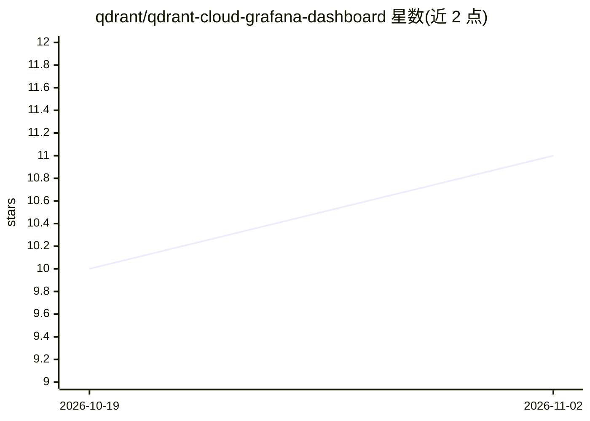

# qdrant/qdrant-cloud-grafana-dashboard

⭐ 11 · Apache-2.0 · 推送 2026-10-09 · [GitHub](https://github.com/qdrant/qdrant-cloud-grafana-dashboard) · 组织维护

**可视化 Qdrant Cloud 数据库集群状态的 Grafana 仪表盘**

由 Qdrant 团队维护的 Grafana 仪表盘仓库，包含两个仪表盘 JSON：Qdrant Cloud Dashboard 用于展示 Qdrant Cloud 平台上数据库集群的性能与状态；Qdrant Cloud Operator Dashboard 用于展示 Hybrid Cloud / Private Cloud 中 operator 组件的指标。明确声明不适用于 Qdrant 开源容器镜像暴露的指标。安装方式为通过 Grafana 的导入功能加载 JSON 文件。

## 筛选速览

| 维度 | 判定 | 备注 |
|---|---|---|
| AI 角色 | `ai-ecosystem` | LLM/agent 周边工具 |
| 许可风险 | `permissive` | Apache-2.0 |
| 部署形态 | `None` |  |
| 模型依赖 | — | README 未给出锁定关系 |
| 硬件要求 | — | 无带数字的原话,不猜 |
| 安装摩擦 | `low` | 无编译、无系统依赖或容器化 |
| 成熟度 | — | 结构信号不足 |

## 能力要点

- 展示 Qdrant Cloud 集群性能与状态的 Grafana 仪表盘
- 独立的 Operator Dashboard 覆盖 Hybrid/Private Cloud 控制面组件
- 以仪表盘 JSON 文件形式提供，经 Grafana 导入使用

## 适用场景

- 在 Grafana 中监控 Qdrant Cloud 数据库集群
- 观察 Hybrid/Private Cloud 部署中 operator 组件的指标

## 场景标签

 · 领域:数据库监控/可观测性

## 证据(README 行号)

> L3: This repository contains Grafana dashboards that are designed to visualize the performance and status of Qdrant data
> L15: This dashboard visualizes metrics from the Qdrant operator component running as part of Qdrant Hybrid Cloud or Qdra

## 星数曲线

2026-10-19 10 → 2026-11-02 11（+1）

---
*卡片 v1 · prompt 1.4 · 生成 2026-11-02 · 置信度 high · 依据 README sha `1d2c993235e9` · [字段定义](../../DATASET.md)*
