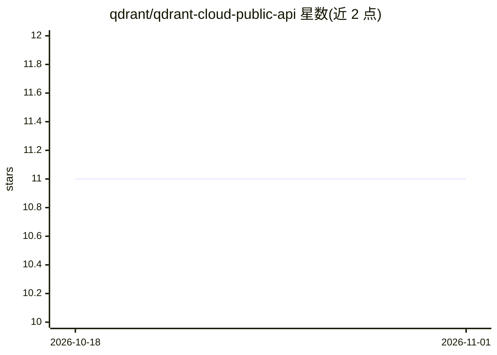

# qdrant/qdrant-cloud-public-api

⭐ 11 · Shell · Apache-2.0 · 推送 2026-10-31 · [GitHub](https://github.com/qdrant/qdrant-cloud-public-api) · 组织维护

**Qdrant Cloud 平台 API 的 proto 定义与 SDK（Go/Python/TS）**

Qdrant 官方仓库，托管 Qdrant Cloud 平台管理 API 的 Protocol Buffer 定义与预生成的 Go/Python/TypeScript 客户端库。API 覆盖集群、备份、计费、IAM、监控、混合云等 17 个 gRPC 服务，提供 gRPC 与经 gRPC Gateway 的 REST/JSON 两种接入方式，认证通过 management key（Authorization header）。README 给出 grpcurl/curl 调用示例、分页机制说明与各语言 SDK 安装方式（Go 直接 import，Python/TS 经 Google Artifact Registry 认证安装），并说明贡献流程（Buf lint、Make 生成代码）。

## 筛选速览

| 维度 | 判定 | 备注 |
|---|---|---|
| AI 角色 | `ai-ecosystem` | LLM/agent 周边工具 |
| 许可风险 | `permissive` | Apache-2.0 |
| 部署形态 | `desktop` | 安装包/桌面程序 |
| 模型依赖 | — | README 未给出锁定关系 |
| 硬件要求 | — | 无带数字的原话,不猜 |
| 安装摩擦 | `low` | 无编译、无系统依赖或容器化 |
| 成熟度 | — | 结构信号不足 |

## 能力要点

- 17 个 gRPC 服务定义（集群/备份/IAM/计费/监控/混合云等）
- 提供 gRPC 与 REST/JSON 双通道端点
- gen/ 目录含 Go/Python/TypeScript 预生成客户端库
- 分页机制（page_size/page_token）逐步引入

## 适用场景

- 用 Go/Python/TS 代码自动化管理 Qdrant Cloud 集群与配置
- 通过 grpcurl/curl 直接调用云平台管理 API
- 构建 Terraform Provider 或自定义运维工具对接 Qdrant Cloud

## 场景标签

 · 领域:AI 基础设施/向量数据库云服务

## 证据(README 行号)

> L7: This repository hosts the Protocol Buffer (`.proto`) definitions that define the contract for interacting with Qdran
> L14: This repository also contains generated client libraries (SDKs) for Go, Python, and TypeScript (found in the `gen/`

## 星数曲线

2026-10-18 11 → 2026-11-01 11（+0）

---
*卡片 v1 · prompt 1.4 · 生成 2026-11-01 · 置信度 mid · 依据 README sha `04ec4826c07a` · [字段定义](../../DATASET.md)*
