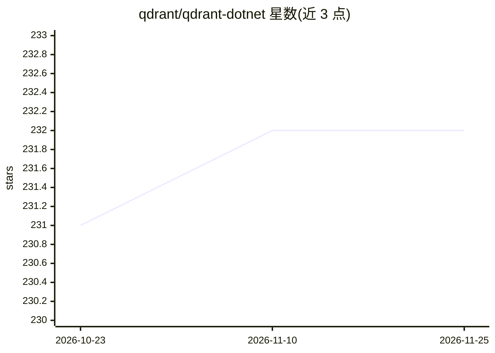

# qdrant/qdrant-dotnet

⭐ 232 · C# · Apache-2.0 · 推送 2026-11-13 · [GitHub](https://github.com/qdrant/qdrant-dotnet) · 组织维护

**面向 .NET 开发者的 Qdrant 向量数据库客户端 SDK**

Qdrant 官方的 .NET 客户端库，以 NuGet 包 Qdrant.Client 发布，通过 dotnet CLI 安装。高层客户端内部使用 gRPC 与 Qdrant 服务端通信，默认连接 localhost:6334，支持 TLS、证书指纹校验与 API key 认证配置；提供集合创建、向量插入、相似向量检索与条件过滤查询等接口，并通过 User-Agent 标识客户端版本。使用示例见 Qdrant 文档；.NET Framework 下 gRPC over HTTP/2 支持受限，需启用 TLS 并配置 WinHttpHandler。

## 筛选速览

| 维度 | 判定 | 备注 |
|---|---|---|
| AI 角色 | `ai-ecosystem` | LLM/agent 周边工具 |
| 许可风险 | `permissive` | Apache-2.0 |
| 部署形态 | `None` |  |
| 模型依赖 | — | README 未给出锁定关系 |
| 硬件要求 | — | 无带数字的原话,不猜 |
| 安装摩擦 | `medium` | 含编译或系统依赖之一 |
| 成熟度 | — | 结构信号不足 |

## 能力要点

- 以 NuGet 包 Qdrant.Client 发布，dotnet add package 安装
- 基于 gRPC 的高层客户端，支持 TLS 与 API key 认证
- 提供集合创建、向量插入、相似检索与条件过滤接口
- 请求中自动添加 qdrant-dotnet/<version> User-Agent 标识

## 适用场景

- 在 .NET 应用中读写 Qdrant 向量集合
- 构建基于向量相似度检索的应用
- 需要 TLS 与 API key 连接 Qdrant 服务的场景

## 场景标签

`向量数据库` · 领域:知识与检索

## 证据(README 行号)

> L1: # Qdrant .NET SDK
> L28: Internally, the high level client uses a low level gRPC client to interact with Qdrant.
> L6: ## 📥 Installation

## 星数曲线

2026-10-23 231 → 2026-11-25 232（+1）

---
*卡片 v1 · prompt 1.4 · 生成 2026-11-25 · 置信度 high · 依据 README sha `fe098bf7ac62` · [字段定义](../../DATASET.md)*
