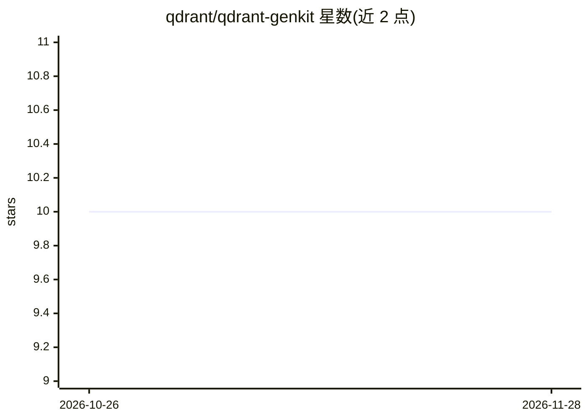

# qdrant/qdrant-genkit

⭐ 10 · TypeScript · Apache-2.0 · 推送 2026-11-14 · [GitHub](https://github.com/qdrant/qdrant-genkit) · 组织维护

**为 Genkit 开发者提供 Qdrant 索引与检索插件**

Genkit 框架的 Qdrant 插件，提供 JS 与 Go 两种实现的 indexer 和 retriever。配置时需指定集合名、嵌入模型与 Qdrant 客户端参数，可选配置 embedderOptions、payload 字段名及集合创建选项。通过 npm 安装，在 configureGenkit() 中注册后即可配合 retrieve() 和 index() 使用，用于构建 RAG 应用。

## 筛选速览

| 维度 | 判定 | 备注 |
|---|---|---|
| AI 角色 | `ai-ecosystem` | LLM/agent 周边工具 |
| 许可风险 | `permissive` | Apache-2.0 |
| 部署形态 | `library` | 以包/库形式分发 |
| 模型依赖 | — | README 未给出锁定关系 |
| 硬件要求 | — | 无带数字的原话,不猜 |
| 安装摩擦 | `low` | 无编译、无系统依赖或容器化 |
| 成熟度 | — | 结构信号不足 |

## 能力要点

- 提供 JS 与 Go 两种语言的 indexer/retriever 实现
- 可配置嵌入模型、payload 字段名与集合创建选项
- 通过 configureGenkit() 注册即可接入 Genkit 流程

## 适用场景

- 在 Genkit 应用中用 Qdrant 做文档索引与检索
- 搭建基于 Qdrant 的 RAG 流程
- 为 Genkit 应用接入向量存储后端

## 场景标签

`RAG` · 领域:知识与检索

## 证据(README 行号)

> L3: The Qdrant plugin provides Genkit indexer and retriever implementations in JS and Go that use the Qdrant.
> L13: To use this plugin, specify it when you call `configureGenkit()`:

## 星数曲线

2026-10-26 10 → 2026-11-28 10（+0）

---
*卡片 v1 · prompt 1.4 · 生成 2026-11-19 · 置信度 high · 依据 README sha `9680596d191b` · [字段定义](../../DATASET.md)*
