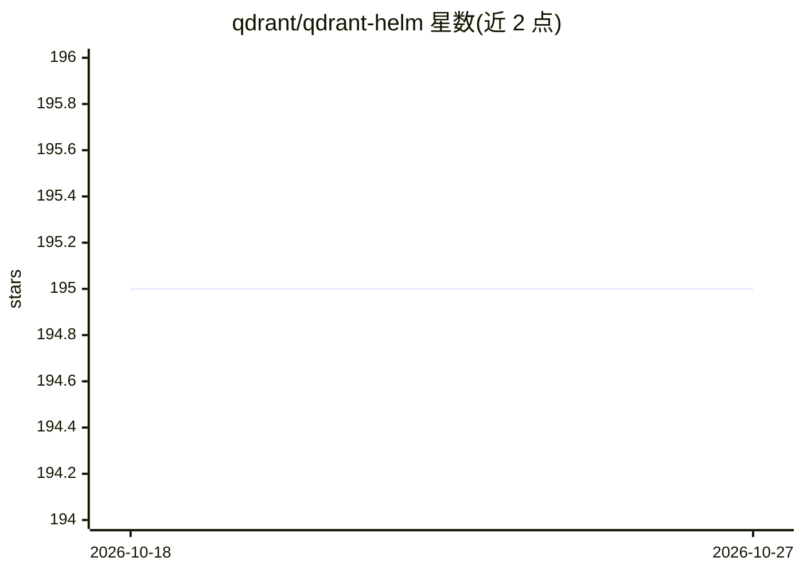

# qdrant/qdrant-helm

⭐ 195 · Go · Apache-2.0 · 推送 2026-10-23 · [GitHub](https://github.com/qdrant/qdrant-helm) · 组织维护

**Qdrant 向量数据库的 Helm Chart 仓库**

由 Qdrant 维护的 Helm Chart 仓库，用于在 Kubernetes 集群中部署和升级 Qdrant。提供 helm repo add 与 helm upgrade 命令完成安装和滚动升级（逐节点更新）。README 明确列出与 Qdrant Cloud 的功能差异：Helm Chart 仅提供社区支持，不包含零停机升级优化、自动分片再平衡、全集群备份与容灾等企业特性，这些由 Qdrant Cloud 或企业 Operator 提供。

## 筛选速览

| 维度 | 判定 | 备注 |
|---|---|---|
| AI 角色 | `ai-ecosystem` | LLM/agent 周边工具 |
| 许可风险 | `permissive` | Apache-2.0 |
| 部署形态 | `library` | 以包/库形式分发 |
| 模型依赖 | — | README 未给出锁定关系 |
| 硬件要求 | — | 无带数字的原话,不猜 |
| 安装摩擦 | `low` | 无编译、无系统依赖或容器化 |
| 成熟度 | — | 结构信号不足 |

## 能力要点

- 通过 helm 命令在 Kubernetes 集群中部署 Qdrant
- helm upgrade 执行逐节点滚动升级
- README 列出与 Qdrant Cloud 的功能对比表

## 适用场景

- 在自管 Kubernetes 集群上运行 Qdrant 向量数据库
- 对新版 Qdrant 执行滚动升级
- 对比 Helm Chart 与 Qdrant Cloud 的功能差异以做部署决策

## 场景标签

`向量数据库` · 领域:知识与检索

## 证据(README 行号)

> L5: This repository hosts the following helm charts:
> L21: You can use this to run Qdrant in your Kubernetes cluster. While it is possible to deploy Qdrant in a distributed s

## 星数曲线

2026-10-18 195 → 2026-10-27 195（+0）

---
*卡片 v1 · prompt 1.4 · 生成 2026-10-22 · 置信度 high · 依据 README sha `70689a3bdf6c` · [字段定义](../../DATASET.md)*
