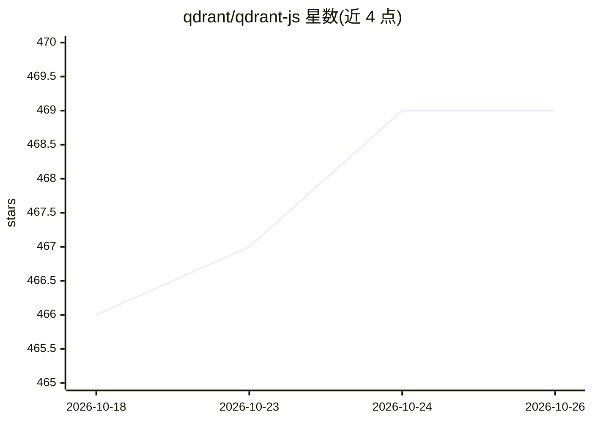

# qdrant/qdrant-js

⭐ 469 · TypeScript · Apache-2.0 · 推送 2026-10-22 · [GitHub](https://github.com/qdrant/qdrant-js) · [官网](https://qdrant.tech) · 组织维护

**Qdrant 向量数据库的 JavaScript/TypeScript SDK**

为 Qdrant 向量搜索引擎提供的 JS/TS 客户端库，发布 3 个包：主 SDK 包 @qdrant/qdrant-js、轻量 REST 客户端 @qdrant/js-client-rest 与 gRPC 客户端 @qdrant/js-client-grpc。支持通过 pnpm/npm/yarn 安装，配合 Qdrant Docker 容器使用，提供实例化客户端与 facade 方法发起请求的示例，examples 目录含更多用例。主次版本号与 Qdrant 引擎版本对齐。面向接入 Qdrant 的 JS/TS 开发者。

## 筛选速览

| 维度 | 判定 | 备注 |
|---|---|---|
| AI 角色 | `ai-ecosystem` | LLM/agent 周边工具 |
| 许可风险 | `permissive` | Apache-2.0 |
| 部署形态 | `self-host` | docker 或自建部署 |
| 模型依赖 | — | README 未给出锁定关系 |
| 硬件要求 | — | 无带数字的原话,不猜 |
| 安装摩擦 | `low` | 无编译、无系统依赖或容器化 |
| 成熟度 | — | 结构信号不足 |

## 能力要点

- 发布 3 个包：主 SDK、REST 客户端、gRPC 客户端
- 支持 pnpm/npm/yarn 安装
- 主次版本号与 Qdrant 引擎发布对齐

## 适用场景

- 在 Node.js 或浏览器项目中连接并操作 Qdrant 向量数据库
- 按需选择 REST 或 gRPC 客户端访问 Qdrant
- 参考 examples 目录快速上手集合管理与检索请求

## 场景标签

`向量数据库` · 领域:知识与检索

## 证据(README 行号)

> L6:  JavaScript/TypeScript library for the Qdrant vector search engine.
> L16: This repository contains packages of the JS SDK for the Qdrant vector search engine.

## 星数曲线

2026-10-18 466 → 2026-10-26 469（+3）

---
*卡片 v1 · prompt 1.4 · 生成 2026-10-21 · 置信度 mid · 依据 README sha `a12a019905bc` · [字段定义](../../DATASET.md)*
