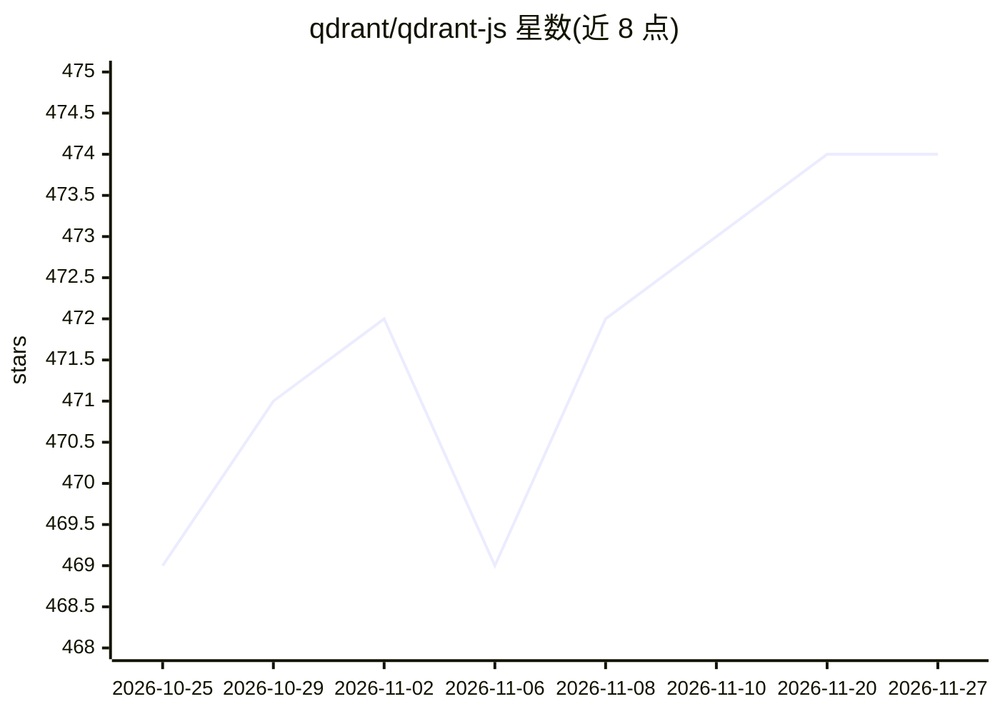

# qdrant/qdrant-js

⭐ 474 · TypeScript · Apache-2.0 · 推送 2026-10-31 · [GitHub](https://github.com/qdrant/qdrant-js) · [官网](https://qdrant.tech) · 组织维护

**Qdrant 向量数据库的 JavaScript/TypeScript 客户端 SDK**

Qdrant 向量搜索引擎的官方 JS SDK 仓库，发布三个 npm 包：主 SDK @qdrant/qdrant-js、轻量 REST 客户端与 gRPC 客户端。安装后实例化 QdrantClient 连接本地或远程 Qdrant 实例，通过 facade 方法执行集合列举等请求；README 提供 pnpm/npm/yarn 三种安装方式，并给出用 Docker 运行 Qdrant 服务的示例。版本节奏与 Qdrant 引擎主/次版本对齐，patch 版本用于当前次版本的修复。

## 筛选速览

| 维度 | 判定 | 备注 |
|---|---|---|
| AI 角色 | `ai-ecosystem` | LLM/agent 周边工具 |
| 许可风险 | `permissive` | Apache-2.0 |
| 部署形态 | `self-host` | docker 或自建部署 |
| 模型依赖 | — | README 未给出锁定关系 |
| 硬件要求 | — | 无带数字的原话,不猜 |
| 安装摩擦 | `low` | 无编译、无系统依赖或容器化 |
| 成熟度 | — | 结构信号不足 |

## 能力要点

- 发布三个包：主 SDK、REST 轻量客户端、gRPC 客户端
- 支持 pnpm/npm/yarn 安装
- 提供连接本地 Qdrant 的客户端实例化与请求示例
- 版本号与 Qdrant 引擎发布对齐

## 适用场景

- 在 Node.js/TypeScript 应用中接入 Qdrant 向量数据库
- 通过 REST 或 gRPC 客户端管理向量集合
- 配合 Docker 运行的 Qdrant 实例做本地开发

## 场景标签

 · 领域:向量数据库/开发工具

## 证据(README 行号)

> L16: This repository contains packages of the JS SDK for the Qdrant vector search engine.
> L20: - `@qdrant/qdrant-js` Code- the main package with the SDK itself.

## 星数曲线

2026-10-25 469 → 2026-11-27 474（+5）

---
*卡片 v1 · prompt 1.4 · 生成 2026-11-25 · 置信度 high · 依据 README sha `bd289c9aa492` · [字段定义](../../DATASET.md)*
