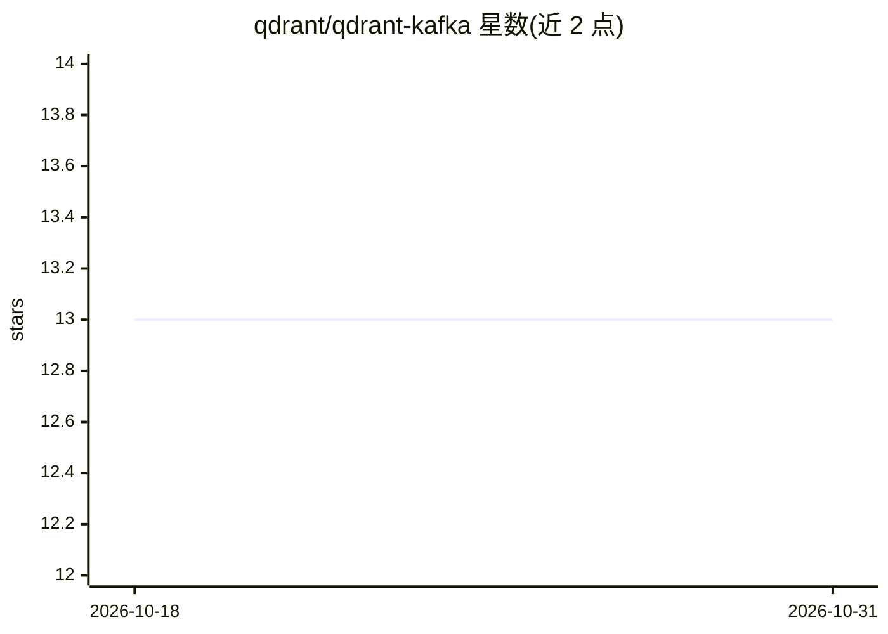

# qdrant/qdrant-kafka

⭐ 13 · Java · Apache-2.0 · 推送 2026-10-23 · [GitHub](https://github.com/qdrant/qdrant-kafka) · 组织维护

**Kafka Connect 的 Qdrant Sink 连接器：把向量数据流式写入 Qdrant**

由 Qdrant 维护的 Kafka Sink Connector，将 Kafka 主题中的数据流式写入 Qdrant 向量数据库集合，支持稠密向量、稀疏向量和多向量消息。通过 gRPC URL 与 API key 配置连接，可指定目标集合名并覆盖记录中的 collection_name 字段；支持 Kafka tombstone（null 值）事件，按记录 key 中的 id 删除对应 Qdrant 点。要求集合预先创建并配置好向量维度。面向搭建流式向量摄取管道的开发者，采用 Apache 2.0 许可。

## 筛选速览

| 维度 | 判定 | 备注 |
|---|---|---|
| AI 角色 | `ai-ecosystem` | LLM/agent 周边工具 |
| 许可风险 | `permissive` | Apache-2.0 |
| 部署形态 | `None` |  |
| 模型依赖 | — | README 未给出锁定关系 |
| 硬件要求 | — | 无带数字的原话,不猜 |
| 安装摩擦 | `low` | 无编译、无系统依赖或容器化 |
| 成熟度 | — | 结构信号不足 |

## 能力要点

- 支持稠密/稀疏/多向量及命名向量组合的消息格式
- tombstone（null 值）事件触发按 id 删除 Qdrant 点
- 通过 qdrant.grpc.url 与 API key 配置连接，集合名可覆盖记录字段

## 适用场景

- 把 Kafka 中的向量数据流式摄取进 Qdrant 集合
- 在 Confluent Cloud 或自托管 Kafka 上向 Qdrant 同步数据
- 通过 tombstone 事件维护 Qdrant 点的删除同步

## 场景标签

 · 领域:数据基础设施/向量数据库集成

## 证据(README 行号)

> L3: Use Qdrant as a sink destination in Kafka Connect. Supports streaming dense/sparse/multi vectors into Qdrant collect
> L89: A Kafka tombstone has a `null` value. The connector deletes the Qdrant point whose `id` appears in the record key.

## 星数曲线

2026-10-18 13 → 2026-10-31 13（+0）

---
*卡片 v1 · prompt 1.4 · 生成 2026-10-31 · 置信度 high · 依据 README sha `d022409c4824` · [字段定义](../../DATASET.md)*
