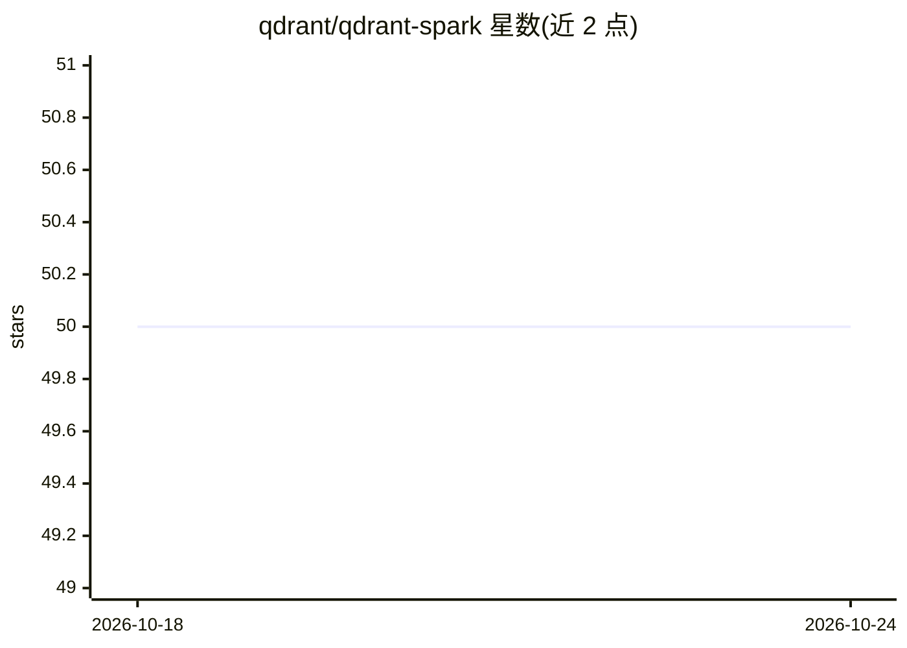

# qdrant/qdrant-spark

⭐ 50 · Java · Apache-2.0 · 推送 2026-10-19 · [GitHub](https://github.com/qdrant/qdrant-spark) · [官网](https://qdrant.tech/documentation/frameworks/spark/) · 组织维护

**将 Spark DataFrame 批量写入 Qdrant 向量库的连接器**

Qdrant 官方维护的 Apache Spark 连接器，以 Spark 数据源（JAR 包）形式提供，使 Qdrant 成为 Spark 的写入目的地。通过 DataFrame.write.format("io.qdrant.spark.Qdrant") 将数据摄入 Qdrant 集合，支持命名/非命名、稠密/稀疏、多向量及纯 payload 等多种写入模式，可配置批大小、重试、shard key、API key 认证等选项，并可在 Databricks 中作为 Maven 库安装。写入前需预先创建好相应维度的集合。从源码构建需 JDK 8 与 Maven。

## 筛选速览

| 维度 | 判定 | 备注 |
|---|---|---|
| AI 角色 | `ai-ecosystem` | LLM/agent 周边工具 |
| 许可风险 | `permissive` | Apache-2.0 |
| 部署形态 | `None` |  |
| 模型依赖 | — | README 未给出锁定关系 |
| 硬件要求 | — | 无带数字的原话,不猜 |
| 安装摩擦 | `low` | 无编译、无系统依赖或容器化 |
| 成熟度 | — | 结构信号不足 |

## 能力要点

- 支持稠密/稀疏/多向量及纯 payload 多种写入模式
- 写入选项含批大小、重试次数、shard key 与 API key 认证
- 可在 Databricks 中以 Maven 库方式安装使用

## 适用场景

- 在 Spark 大数据管线中将向量批量摄入 Qdrant
- 在 Databricks 集群上向 Qdrant 写入 embedding 数据

## 场景标签

`向量数据库` · 领域:知识与检索

## 证据(README 行号)

> L3: Apache Spark is a distributed computing framework designed for big data processing and analytics. This connector ena
> L53:    .format("io.qdrant.spark.Qdrant")

## 星数曲线

2026-10-18 50 → 2026-10-24 50（+0）

---
*卡片 v1 · prompt 1.4 · 生成 2026-10-24 · 置信度 high · 依据 README sha `5e88a4474fdc` · [字段定义](../../DATASET.md)*
