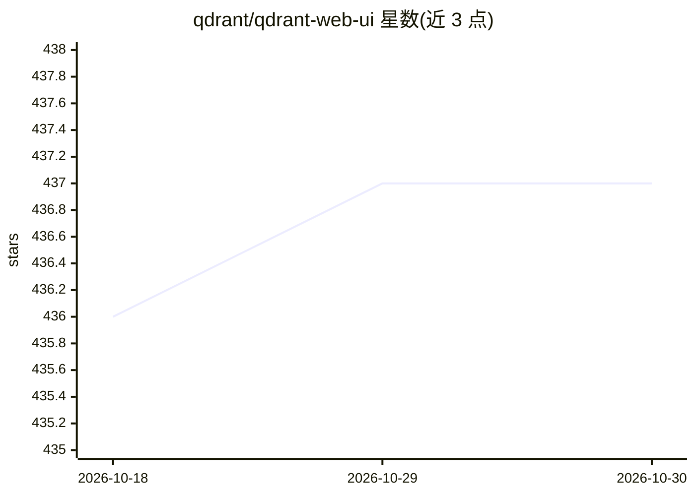

# qdrant/qdrant-web-ui

⭐ 437 · JavaScript · Apache-2.0 · 推送 2026-10-21 · [GitHub](https://github.com/qdrant/qdrant-web-ui) · 组织维护

**Qdrant 向量检索引擎的自托管 Web 管理界面**

自托管的 Qdrant 向量搜索引擎 Web UI，用于查看和管理 collections，可由 Qdrant 自身提供服务，也可作为独立应用运行，不需要额外服务（README 类比 Kibana 之于 Elasticsearch）。技术栈为 React、MUI 与 Axios。开发模式下预期 Qdrant 运行于 localhost:6333，通过 npm start/build 等脚本进行开发与构建，属于 npm 源码项目，无桌面安装包。

## 筛选速览

| 维度 | 判定 | 备注 |
|---|---|---|
| AI 角色 | `ai-ecosystem` | LLM/agent 周边工具 |
| 许可风险 | `permissive` | Apache-2.0 |
| 部署形态 | `None` |  |
| 模型依赖 | — | README 未给出锁定关系 |
| 硬件要求 | — | 无带数字的原话,不猜 |
| 安装摩擦 | `low` | 无编译、无系统依赖或容器化 |
| 成熟度 | — | 结构信号不足 |

## 能力要点

- 查看与管理 Qdrant collections 的 Web 界面
- 可由 Qdrant 自身提供服务，也可独立运行
- 无需额外服务（类比 Kibana）
- React + MUI + Axios 技术栈

## 适用场景

- 在浏览器中查看和管理 Qdrant 向量数据库的 collections
- 配合自托管的 Qdrant 实例做数据管理
- 作为独立应用部署用于 Qdrant 运维

## 场景标签

 · 领域:向量数据库/开发工具

## 证据(README 行号)

> L3: This is a self-hosted web UI for Qdrant Vector Search Engine.
> L5: This UI is supposed to be served by Qdrant itself, but you can use it as a standalone application.

## 星数曲线

2026-10-18 436 → 2026-10-30 437（+1）

---
*卡片 v1 · prompt 1.4 · 生成 2026-10-21 · 置信度 high · 依据 README sha `e34ca750b6f6` · [字段定义](../../DATASET.md)*
