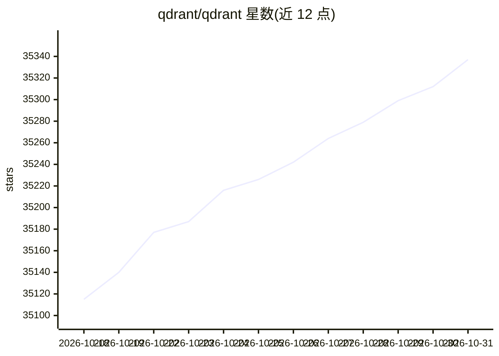

# qdrant/qdrant

⭐ 35,337 · Rust · Apache-2.0 · 推送 2026-10-30 · [GitHub](https://github.com/qdrant/qdrant) · [官网](https://qdrant.tech) · 组织维护

**AI 应用的向量相似度搜索引擎与向量数据库**

以 Rust 编写的向量数据库服务，提供 REST 与 gRPC API 存储、搜索和管理带 payload 的向量点。支持稠密/稀疏/多向量检索、payload 过滤、混合搜索（RRF/DBSF 融合）、量化与磁盘存储、分片与复制的分布式部署。官方提供 Docker 部署方式与 Go/Rust/JS/Python/.NET/Java 客户端，另有面向边缘设备的 Qdrant Edge 版本和托管云服务（含免费层）。

## 筛选速览

| 维度 | 判定 | 备注 |
|---|---|---|
| AI 角色 | `ai-native` | 本体是模型或模型工具 |
| 许可风险 | `permissive` | Apache-2.0 |
| 部署形态 | `self-host` | docker 或自建部署 |
| 模型依赖 | — | README 未给出锁定关系 |
| 硬件要求 | — | 无带数字的原话,不猜 |
| 安装摩擦 | `low` | 无编译、无系统依赖或容器化 |
| 成熟度 | — | 结构信号不足 |

## 动量与使用信号

- 维护:`active` — 距上次 push 0.7 天,年发版 13,204 位贡献者
- 涨星:近 1 天 **+20**(自 20261016 起算)

## 能力要点

- 稠密、稀疏与多向量搜索，支持 ColBERT 类 late interaction 模型
- payload 过滤与混合搜索（RRF/DBSF 融合策略）
- 分布式部署：分片、复制、零停机扩缩容
- GPU 加速索引（NVIDIA/AMD），SIMD 硬件加速

## 适用场景

- 为语义搜索应用搭建向量检索后端
- 构建以图搜图的视觉发现功能
- 电商平台的多标签商品分类检索
- 为 RAG 类应用提供推荐与匹配服务

## 场景标签

`向量数据库` · 领域:知识与检索

## 证据(README 行号)

> L12: **Qdrant** (read: _quadrant_) is a vector similarity search engine and vector database.
> L28: Qdrant provides a collection of ready-to-use agent skills that bring Qdrant's vector search capabilities directly i
> L115: Qdrant supports dense vectors for semantic similarity, sparse vectors for full-text search, and multivector search

## 星数曲线

2026-10-18 35,115 → 2026-10-31 35,337（+222）

---
*卡片 v1 · prompt 1.4 · 生成 2026-10-18 · 置信度 high · 依据 README sha `de584bc74517` · [字段定义](../../DATASET.md)*
