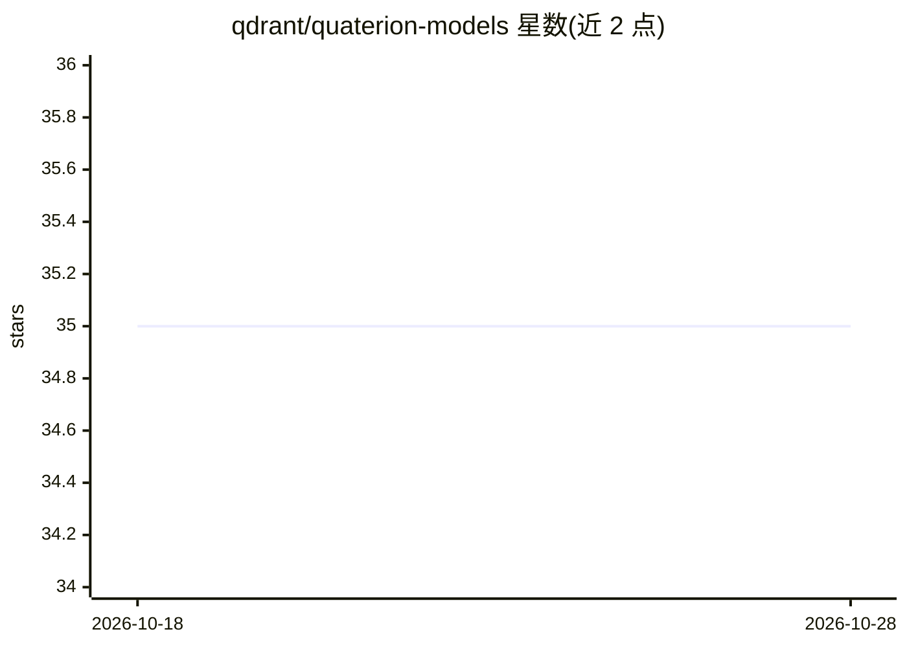

# qdrant/quaterion-models

⭐ 35 · Python · Apache-2.0 · 推送 2026-10-05 · [GitHub](https://github.com/qdrant/quaterion-models) · [官网](https://quaterion-models.qdrant.tech/) · 组织维护

**度量学习模型的推理构件库：轻量加载与编码**

Quaterion 相似度学习框架的独立子包，剥离训练依赖，用于已训练相似度模型的加载与推理。提供 SimilarityModel 主类（含编码器与 head 层）、Encoder 基类、多种 Head Layer 实现及辅助函数。仅做推理时可不装主框架单独安装，通过 pip 提供 Python 包，面向构建相似度/检索系统的开发者。

## 筛选速览

| 维度 | 判定 | 备注 |
|---|---|---|
| AI 角色 | `ai-ecosystem` | LLM/agent 周边工具 |
| 许可风险 | `permissive` | Apache-2.0 |
| 部署形态 | `library` | 以包/库形式分发 |
| 模型依赖 | — | README 未给出锁定关系 |
| 硬件要求 | — | 无带数字的原话,不猜 |
| 安装摩擦 | `low` | 无编译、无系统依赖或容器化 |
| 成熟度 | — | 结构信号不足 |

## 能力要点

- SimilarityModel：编码器加 head 层的推理主类
- 独立于训练框架的轻量推理包
- Encoder 基类与多种 Head Layer 实现

## 适用场景

- 加载已训练的相似度模型做向量编码与推理
- 构建检索/相似度匹配系统时复用编码构件

## 场景标签

`语义搜索` · 领域:知识与检索

## 证据(README 行号)

> L3: `quaterion-models` is a part of `Quaterion`, similarity learning framework.
> L6: It contains definition of base classes, used for model inference, as well as the collection of building blocks for b

## 星数曲线

2026-10-18 35 → 2026-10-28 35（+0）

---
*卡片 v1 · prompt 1.4 · 生成 2026-10-25 · 置信度 high · 依据 README sha `dfc276af66d7` · [字段定义](../../DATASET.md)*
