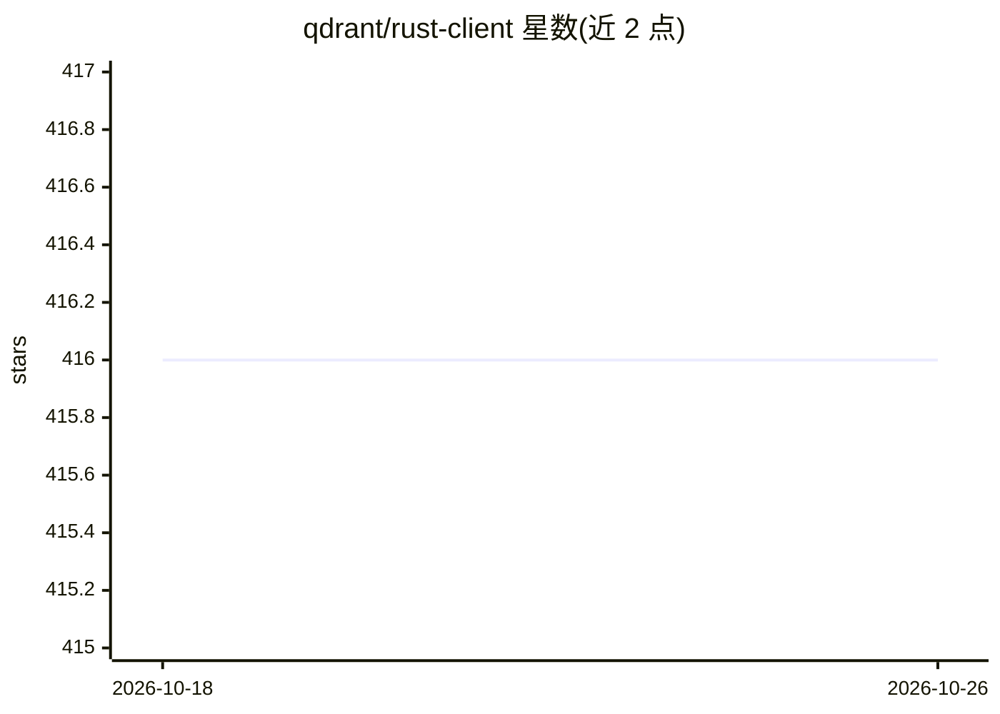

# qdrant/rust-client

⭐ 416 · Rust · Apache-2.0 · 推送 2026-10-22 · [GitHub](https://github.com/qdrant/rust-client) · [官网](https://crates.io/crates/qdrant-client) · 组织维护

**Qdrant 向量数据库的 Rust 客户端库**

由 Qdrant 官方维护的 Rust SDK，通过 gRPC（Tonic 库）连接 Qdrant 向量搜索引擎，提供建集合、upsert、过滤查询、标量量化等操作的类型化 API。以 crates.io 包形式安装（cargo add qdrant-client），示例涵盖查询代码片段与可直接运行的 examples；另说明通过 URL、端口 6334 与 API key 接入 Qdrant Cloud 托管服务的配置方式。修改协议定义需要 protoc 编译器。

## 筛选速览

| 维度 | 判定 | 备注 |
|---|---|---|
| AI 角色 | `ai-ecosystem` | LLM/agent 周边工具 |
| 许可风险 | `permissive` | Apache-2.0 |
| 部署形态 | `self-host` | docker 或自建部署 |
| 模型依赖 | — | README 未给出锁定关系 |
| 硬件要求 | — | 无带数字的原话,不猜 |
| 安装摩擦 | `low` | 无编译、无系统依赖或容器化 |
| 成熟度 | — | 结构信号不足 |

## 能力要点

- 基于 gRPC/Tonic 与 Qdrant 服务端通信
- 提供集合创建、upsert、过滤查询、量化等类型化构建器 API
- 示例目录可直接 cargo run --example 运行
- 说明接入 Qdrant Cloud 的端口与 API key 配置

## 适用场景

- 在 Rust 项目中接入 Qdrant 向量数据库
- 为语义检索/RAG 应用存储与查询向量
- 连接 Qdrant Cloud 托管服务

## 场景标签

`向量数据库` · 领域:知识与检索

## 证据(README 行号)

> L1: # Qdrant Rust client
> L3: The Qdrant - High-Performance Vector Search at Scale - client for Rust.
> L28: The client uses gRPC via the Tonic library.

## 星数曲线

2026-10-18 416 → 2026-10-26 416（+0）

---
*卡片 v1 · prompt 1.4 · 生成 2026-10-21 · 置信度 mid · 依据 README sha `6ded62ac58bb` · [字段定义](../../DATASET.md)*
