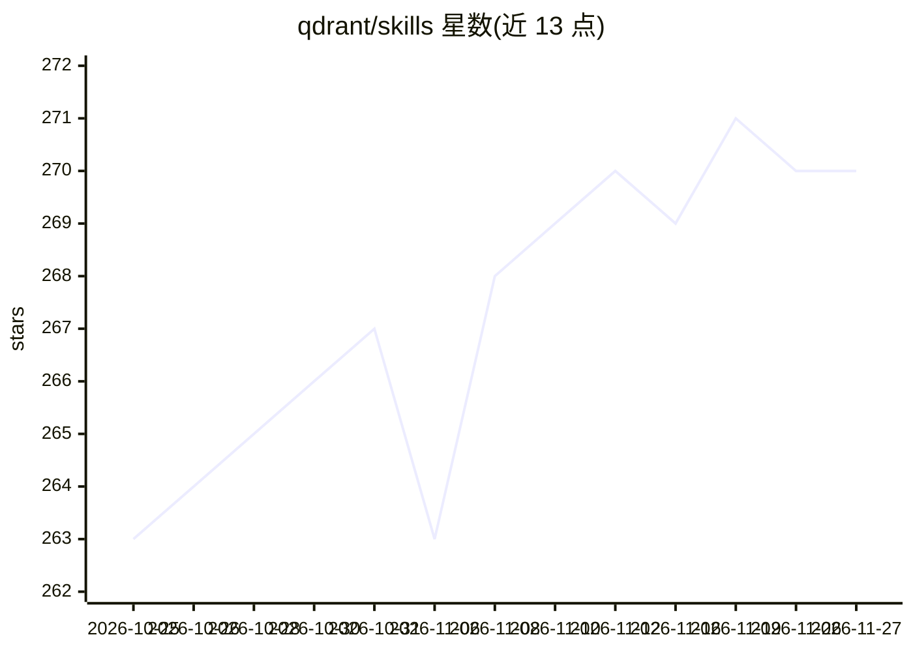

# qdrant/skills

⭐ 270 · Python · Apache-2.0 · 推送 2026-11-26 · [GitHub](https://github.com/qdrant/skills) · [官网](https://skills.qdrant.tech) · 组织维护

**给编码 agent 提供 Qdrant 向量搜索工程决策知识的技能集**

由 Qdrant 维护的面向编码 agent 的技能集合，内容按解决方案架构师手册结构组织：覆盖量化、分片、租户隔离、混合搜索、模型迁移、版本升级、监控与部署等工程决策，定位是回答"何时/为何"而非"如何"。提供三种使用方式：安装 Qdrant Advisor 元技能（实时从 skills.qdrant.tech 拉取最新内容）、在提示词中直接传 URL、或离线安装完整技能集。支持 Claude Code、Cursor、OpenCode、OpenAI Codex、Pi 等多个 agent 目录。技能仍在活跃开发中，内容与结构可能随版本变化。

## 筛选速览

| 维度 | 判定 | 备注 |
|---|---|---|
| AI 角色 | `ai-knowledge` | 知识聚合/清单类 |
| 许可风险 | `permissive` | Apache-2.0 |
| 部署形态 | `library` | 以包/库形式分发 |
| 模型依赖 | — | README 未给出锁定关系 |
| 硬件要求 | — | 无带数字的原话,不猜 |
| 安装摩擦 | `low` | 无编译、无系统依赖或容器化 |
| 成熟度 | `idea` | |

## 能力要点

- 15 个技能覆盖 SDK、扩容、性能、搜索质量、监控、多租户、部署与迁移
- Qdrant Advisor 元技能每次会话实时拉取 skills.qdrant.tech 最新内容，无需重装
- 支持 Python、TypeScript、Rust、Go、.NET、Java 六种语言的 SDK 技能
- 提供 npx skills、Claude Code 插件市场、Cursor Marketplace 等多种安装途径

## 适用场景

- 用编码 agent 开发 Qdrant 应用时获得扩容与量化决策建议
- 在不停机情况下切换嵌入模型的方案咨询
- 为 Qdrant 部署做 RAM、磁盘、CPU 与节点数预估
- 从其他向量数据库向 Qdrant 迁移数据

## 场景标签

`编码 Agent` · 领域:编码与开发

## 证据(README 行号)

> L1: # Qdrant Skills - Agent Skills for Qdrant Vector Search
> L7: Skills encode deep Qdrant knowledge so coding agents can make the engineering decisions that determine whether vecto
> L21: These skills are under active development. Skill content and structure may change between versions as Qdrant evolve

## 星数曲线

2026-10-25 263 → 2026-11-27 270（+7）

---
*卡片 v1 · prompt 1.4 · 生成 2026-11-26 · 置信度 high · 依据 README sha `76cfd4e45b25` · [字段定义](../../DATASET.md)*
