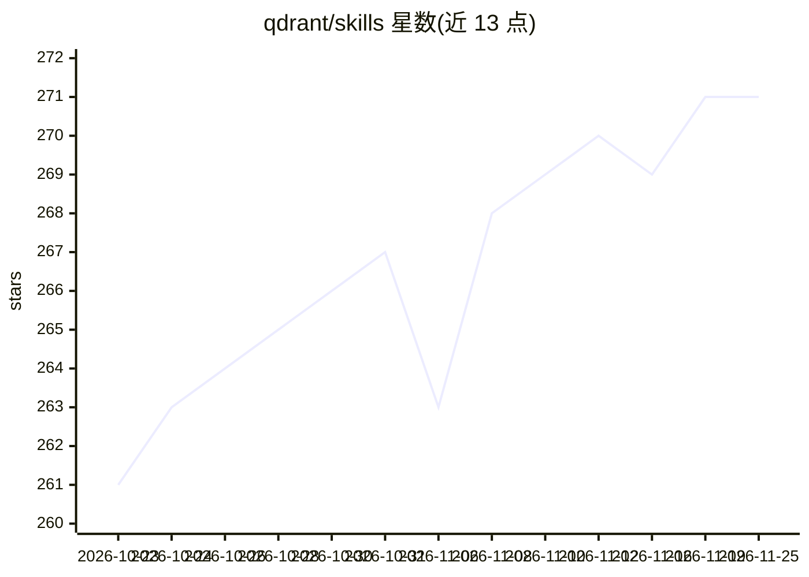

# qdrant/skills

⭐ 271 · Python · Apache-2.0 · 推送 2026-11-23 · [GitHub](https://github.com/qdrant/skills) · [官网](https://skills.qdrant.tech) · 组织维护

**给编码 agent 用的 Qdrant 向量检索技能集**

Qdrant 官方维护的 agent 技能集，将量化、分片、租户隔离、混合检索、模型迁移、版本升级等 Qdrant 工程决策知识编码为技能，供 Claude Code、Cursor 等编码 agent 加载。定位为解决方案架构师手册：只回答“何时、为何”，不含教程。推荐通过 Qdrant Advisor 元技能实时从 skills.qdrant.tech 拉取最新指引；也支持 URL 直传、npx 全量安装或按 agent 目录手动复制。处于活跃开发中，内容与结构可能随版本变化。

## 筛选速览

| 维度 | 判定 | 备注 |
|---|---|---|
| AI 角色 | `ai-knowledge` | 知识聚合/清单类 |
| 许可风险 | `permissive` | Apache-2.0 |
| 部署形态 | `library` | 以包/库形式分发 |
| 模型依赖 | — | README 未给出锁定关系 |
| 硬件要求 | — | 无带数字的原话,不猜 |
| 安装摩擦 | `low` | 无编译、无系统依赖或容器化 |
| 成熟度 | `idea` | |

## 能力要点

- 14 个技能覆盖 SDK、扩容、容量规划、性能、检索质量、监控、多租户、部署与迁移
- Qdrant Advisor 元技能每次会话实时拉取 skills.qdrant.tech 的最新指引
- 支持 npx skills CLI、Claude Code 插件市场、Cursor 市场及手动复制多种安装方式
- SDK 覆盖 Python、TypeScript、Rust、Go、.NET、Java

## 适用场景

- 让编码 agent 在写 Qdrant 相关代码时获得扩容、量化等工程决策指引
- 无需安装时直接在提示词中传 URL 让 agent 拉取对应技能
- 离线环境下把完整技能集安装到本地 agent 目录
- 切换 embedding 模型或升级 Qdrant 版本时咨询安全路径

## 场景标签

`提示工程` · 领域:Agent 开发

## 证据(README 行号)

> L7: Skills encode deep Qdrant knowledge so coding agents can make the engineering decisions that determine whether vecto
> L14: They are structured as the handbook of a Solutions Architect working on Qdrant:
> L76: |qdrant-clients-sdk|SDK setup, code examples, snippet search across Python, TypeScript, Rust, Go, .NET, Java|

## 星数曲线

2026-10-23 261 → 2026-11-25 271（+10）

---
*卡片 v1 · prompt 1.4 · 生成 2026-11-25 · 置信度 high · 依据 README sha `c9dc92aa35d3` · [字段定义](../../DATASET.md)*
