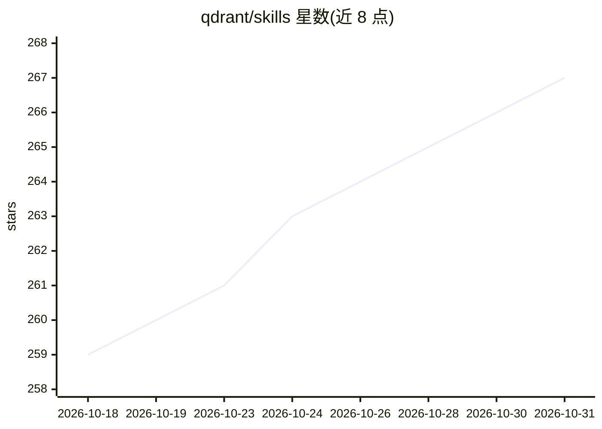

# qdrant/skills

⭐ 267 · Python · Apache-2.0 · 推送 2026-10-27 · [GitHub](https://github.com/qdrant/skills) · [官网](https://skills.qdrant.tech) · 组织维护

**Qdrant 官方维护的向量数据库 agent 技能集：覆盖部署调优决策知识**

Qdrant 公司发布的编码 agent 技能（skills）合集：以解决方案架构师手册的形式组织，回答量化、分片、租户隔离、混合搜索、模型迁移、版本升级等问题的"何时/为何"决策，附 14 个技能条目（SDK、扩展、性能、监控、多云部署、边缘分片等）。推荐安装 Qdrant Advisor 元技能，实时从 skills.qdrant.tech 拉取最新指引；也可通过 npx skills、Claude Code 插件市场、Cursor Marketplace 或克隆仓库离线安装，并可与两个 MCP 服务器配合使用。技能内容仍在活跃开发中，版本间可能变动。

## 筛选速览

| 维度 | 判定 | 备注 |
|---|---|---|
| AI 角色 | `ai-knowledge` | 知识聚合/清单类 |
| 许可风险 | `permissive` | Apache-2.0 |
| 部署形态 | `library` | 以包/库形式分发 |
| 模型依赖 | — | README 未给出锁定关系 |
| 硬件要求 | — | 无带数字的原话,不猜 |
| 安装摩擦 | `low` | 无编译、无系统依赖或容器化 |
| 成熟度 | `idea` | |

## 能力要点

- 14 个技能条目覆盖 SDK、扩展、性能、监控、多租户、部署、迁移等
- Qdrant Advisor 元技能实时在线拉取最新指引，无需重装保持更新
- 支持 Claude Code、Cursor、OpenCode、OpenAI Codex、Pi 等多种 agent 安装
- 可与 mcp-code-snippets、mcp-server-qdrant 两个 MCP 服务器搭配

## 适用场景

- 让编码 agent 在 Qdrant 项目中自行做出分片、量化、扩容等工程决策
- 离线环境下为 agent 提供 Qdrant 部署与调优知识
- 排查搜索质量差、延迟高、集群异常等 Qdrant 问题

## 场景标签

`向量数据库` · 领域:知识与检索

## 证据(README 行号)

> L7: Skills encode deep Qdrant knowledge so coding agents can make the engineering decisions that determine whether vecto
> L74: |Skill|Useful for|

## 星数曲线

2026-10-18 259 → 2026-10-31 267（+8）

---
*卡片 v1 · prompt 1.4 · 生成 2026-10-22 · 置信度 high · 依据 README sha `51a192690d57` · [字段定义](../../DATASET.md)*
