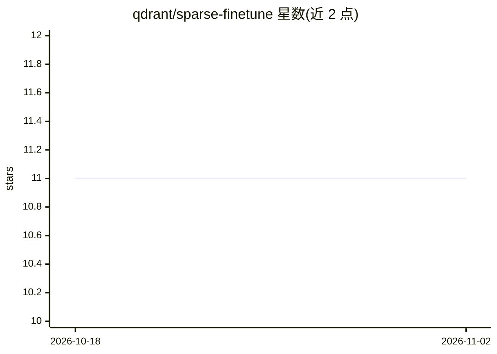

# qdrant/sparse-finetune

⭐ 11 · Python · 推送 2026-10-06 · [GitHub](https://github.com/qdrant/sparse-finetune) · 组织维护

**微调 SPLADE 稀疏嵌入模型的工具包，面向商品目录检索**

Qdrant 维护的 SPLADE 稀疏嵌入微调工具：读取商品数据（CSV/JSON/JSONL/HuggingFace 数据集），用 LLM 生成合成查询，经 3 轮 ANCE 困难负例挖掘（基于 Qdrant 检索）训练 SPLADE 编码器并保存模型。提供 CLI（setup/train/evaluate/index/generate-queries）、Python API 与 Trainer 类；合成查询经 litellm 支持 OpenAI、Anthropic、OpenRouter 与本地 Ollama；可选 Modal 云 GPU（A10G）训练。要求 Python 3.10+ 与一个运行中的 Qdrant 实例，GPU 推荐但非必需。

## 筛选速览

| 维度 | 判定 | 备注 |
|---|---|---|
| AI 角色 | `ai-ecosystem` | LLM/agent 周边工具 |
| 许可风险 | `none` | — |
| 部署形态 | `library` | 以包/库形式分发 |
| 模型依赖 | local-ok | 支持本地模型 |
| 硬件要求 | — | 无带数字的原话,不猜 |
| 安装摩擦 | `low` | 无编译、无系统依赖或容器化 |
| 成熟度 | — | 结构信号不足 |

## 能力要点

- 一行 Python 或 CLI 完成从数据到模型的训练流水线
- ANCE 困难负例挖掘基于 Qdrant 检索进行
- LLM 合成查询支持 OpenAI/Anthropic/OpenRouter/本地 Ollama
- 评估输出 nDCG、MRR、Recall、Precision 指标

## 适用场景

- 为自己的商品目录微调 SPLADE 稀疏检索模型
- 无标注查询时用 LLM 生成合成训练数据
- 用 Modal 云 GPU 免本地硬件完成训练

## 场景标签

`微调` `语义搜索` · 领域:知识与检索

## 证据(README 行号)

> L3: Fine-tune SPLADE sparse embeddings for any product catalog with ANCE hard negative mining via Qdrant.
> L13: That's it. Loads your data, generates synthetic queries via LLM, trains a SPLADE encoder with 3 rounds of ANCE hard

## 星数曲线

2026-10-18 11 → 2026-11-02 11（+0）

---
*卡片 v1 · prompt 1.4 · 生成 2026-11-01 · 置信度 mid · 依据 README sha `7327768354f8` · [字段定义](../../DATASET.md)*
