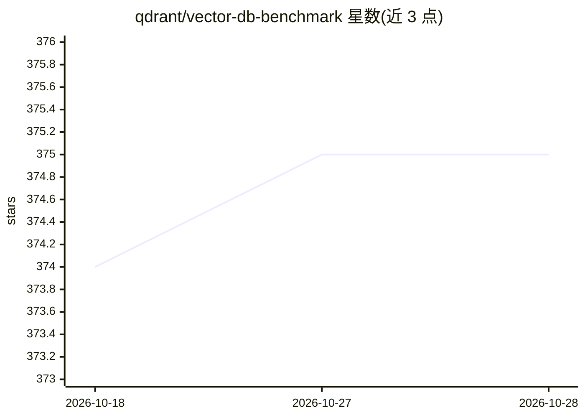

# qdrant/vector-db-benchmark

⭐ 375 · Python · Apache-2.0 · 推送 2026-10-26 · [GitHub](https://github.com/qdrant/vector-db-benchmark) · [官网](https://qdrant.tech/benchmarks/) · 组织维护

**向量搜索引擎性能基准测试框架：统一硬件下对比多种引擎**

在相同硬件约束下对不同向量搜索引擎做基准测试的通用框架，采用服务器-客户端模式：各引擎通过 docker compose 启动服务端，客户端用 Python（poetry 管理依赖）运行 run.py 指定引擎、数据集与场景（单机/分布式、客户端数量等）。支持通配符批量选择引擎与数据集，结果存入 ./results/ 目录。各引擎通过 connection/collection/upload/search 四类配置文件定义参数，数据集在 datasets/datasets.json 中注册并自动下载；提供 BaseConfigurator/BaseUploader/BaseSearcher 基类与 ClientFactory 注册机制以接入新引擎。

## 筛选速览

| 维度 | 判定 | 备注 |
|---|---|---|
| AI 角色 | `ai-ecosystem` | LLM/agent 周边工具 |
| 许可风险 | `permissive` | Apache-2.0 |
| 部署形态 | `self-host` | docker 或自建部署 |
| 模型依赖 | — | README 未给出锁定关系 |
| 硬件要求 | — | 无带数字的原话,不猜 |
| 安装摩擦 | `low` | 无编译、无系统依赖或容器化 |
| 成熟度 | — | 结构信号不足 |

## 能力要点

- 服务器-客户端模式，各引擎统一以 docker compose 提供服务端
- 引擎/数据集/场景三维配置，支持通配符批量运行
- 四类配置文件（connection/collection/upload/search）定义各引擎参数
- 基类 + ClientFactory 机制支持接入新引擎

## 适用场景

- 在同一硬件下对比多个向量搜索引擎的性能以辅助选型
- 针对特定数据集与负载场景自定义基准参数
- 为新引擎实现基准适配并纳入统一测试

## 场景标签

`向量数据库` · 领域:知识与检索

## 证据(README 行号)

> L11: project is a general framework for benchmarking different engines under the
> L21: Benchmarks are implemented in server-client mode, meaning that the server is

## 星数曲线

2026-10-18 374 → 2026-10-28 375（+1）

---
*卡片 v1 · prompt 1.4 · 生成 2026-10-21 · 置信度 mid · 依据 README sha `2d3b535de5cd` · [字段定义](../../DATASET.md)*
