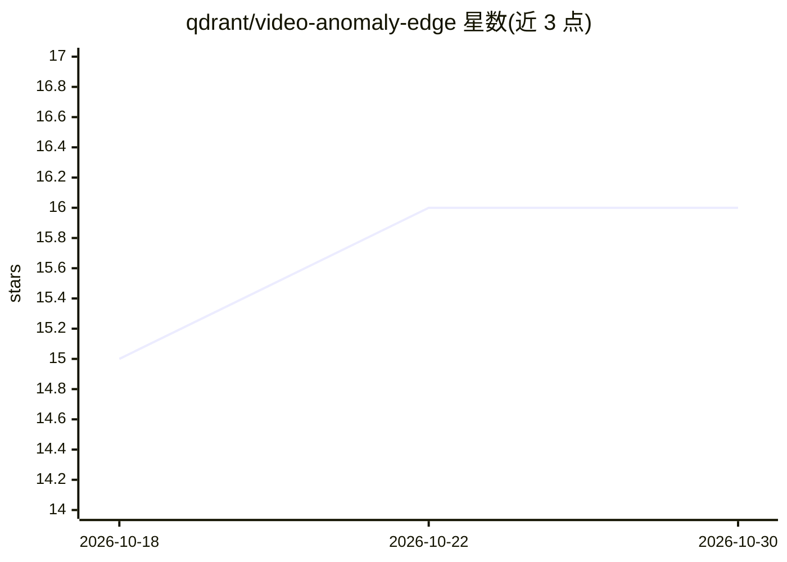

# qdrant/video-anomaly-edge

⭐ 16 · TypeScript · 推送 2026-10-28 · [GitHub](https://github.com/qdrant/video-anomaly-edge) · 组织维护

**边缘到云的实时视频异常检测参考架构（Qdrant）**

由 Qdrant 维护的端到端视频异常检测系统：不在边缘设备（NVIDIA Jetson）上用 Qdrant Edge 做两分片 kNN 初筛，云侧用 Vultr GPU 运行 Twelve Labs Marengo 3.0 与 NVIDIA Metropolis VSS 做进一步分析，前端为 Next.js 仪表盘。机制上不做异常分类，而是索引正常活动嵌入作为基线，将远离基线的片段标记为异常，无需异常标注与再训练。在 UCF Crime 数据集上报告 94% recall、0.97 AUC-ROC、约 10% 片段升级至云端。提供 git clone 快速启动、基线构建与评估脚本、Terraform 部署配置。

## 筛选速览

| 维度 | 判定 | 备注 |
|---|---|---|
| AI 角色 | `ai-native` | 本体是模型或模型工具 |
| 许可风险 | `none` | — |
| 部署形态 | `self-host` | docker 或自建部署 |
| 模型依赖 | — | README 未给出锁定关系 |
| 硬件要求 | — | 无带数字的原话,不猜 |
| 安装摩擦 | `low` | 无编译、无系统依赖或容器化 |
| 成熟度 | — | 结构信号不足 |

## 能力要点

- 将异常检测转化为最近邻搜索：以正常活动嵌入为基线，无需异常标注
- Qdrant Edge 两分片 kNN 初筛 + 约 10% 片段升级云端的两级架构
- 组件含 Twelve Labs Marengo 3.0、NVIDIA Metropolis VSS、VideoMAE、Next.js 仪表盘
- 提供基线构建、评估脚本与 Vultr Terraform 部署配置

## 适用场景

- 在边缘设备上实时监控摄像头画面并标记异常片段
- 无需异常标注数据即可建立异常检测基线
- 评估检测召回率与云端升级比例

## 场景标签

`图像视频处理` · 领域:感知与多模态

## 证据(README 行号)

> L3: Real-time video anomaly detection from edge to cloud using Qdrant Edge, Twelve Labs Marengo 3.0, NVIDIA Metropolis V
> L5: Instead of classifying anomalies, the system treats detection as a nearest-neighbor search problem: index embeddings

## 星数曲线

2026-10-18 15 → 2026-10-30 16（+1）

---
*卡片 v1 · prompt 1.4 · 生成 2026-10-30 · 置信度 high · 依据 README sha `9d9464a9112c` · [字段定义](../../DATASET.md)*
