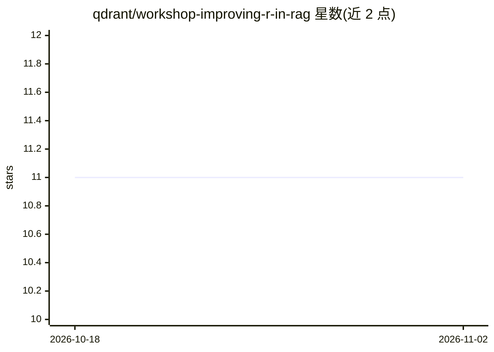

# qdrant/workshop-improving-r-in-rag

⭐ 11 · Jupyter Notebook · 推送 2026-06-23 · [GitHub](https://github.com/qdrant/workshop-improving-r-in-rag) · 组织维护

**Qdrant 检索增强实操工坊：用 HackerNews 数据优化 RAG 的检索环节**

由 Qdrant 维护的 Jupyter notebook 实操工坊，聚焦提升 RAG 系统中的检索（R）部分：以 HackerNews 数据集为语料，通过 4 个递进 notebook 演示稠密向量、BM25 稀疏向量、ColBERT 多向量、混合检索、重排与融合、MMR 多样性及业务规则过滤等技巧。技术栈为 Qdrant 向量数据库、FastEmbed 与 any-llm-sdk，支持 HuggingFace（免费档）、Anthropic、OpenAI 三种 LLM 提供方，可用本地 Docker 或 Qdrant Cloud 免费档运行。

## 筛选速览

| 维度 | 判定 | 备注 |
|---|---|---|
| AI 角色 | `ai-knowledge` | 知识聚合/清单类 |
| 许可风险 | `none` | — |
| 部署形态 | `self-host` | docker 或自建部署 |
| 模型依赖 | — | README 未给出锁定关系 |
| 硬件要求 | — | 无带数字的原话,不猜 |
| 安装摩擦 | `low` | 无编译、无系统依赖或容器化 |
| 成熟度 | — | 结构信号不足 |

## 能力要点

- 4 个递进 notebook 覆盖稠密/稀疏/多向量与混合检索
- 含检索+重排、融合方法与 MMR 结果多样性技术
- 支持 HuggingFace/Anthropic/OpenAI 三种 LLM 提供方
- Qdrant 可本地 Docker 运行或使用 Cloud 免费档

## 适用场景

- 学习如何改进 RAG 系统的检索质量
- 上手 Qdrant 混合检索与多向量表征
- 了解生产环境 RAG 的业务规则与多样性优化

## 场景标签

`RAG` `教程课程` · 领域:知识与检索

## 证据(README 行号)

> L3: This workshop focuses on enhancing the **R**etrieval component in Retrieval Augmented Generation (RAG) systems using
> L101: This workshop consists of 4 progressive notebooks:

## 星数曲线

2026-10-18 11 → 2026-11-02 11（+0）

---
*卡片 v1 · prompt 1.4 · 生成 2026-11-01 · 置信度 mid · 依据 README sha `7f4fa3845ee2` · [字段定义](../../DATASET.md)*
