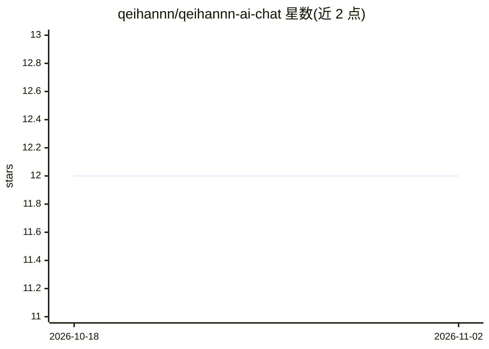

# qeihannn/qeihannn-ai-chat

⭐ 12 · TypeScript · 推送 2025-12-05 · [GitHub](https://github.com/qeihannn/qeihannn-ai-chat) · 个人维护

**本地运行的 AI 聊天界面，基于 Ollama 隐私优先**

基于 React + TypeScript + Vite 构建的轻量本地聊天界面，面向希望在本机运行 AI 对话的用户；通过 Ollama 运行本地模型（README 示例为 deepseek-r1:1.5b），数据不出本地。README 内容多为 Vite 模板默认说明（插件与 ESLint 配置），产品自身的功能描述与安装运行细节信息有限，依赖仓库主题标签与描述补充。

## 筛选速览

| 维度 | 判定 | 备注 |
|---|---|---|
| AI 角色 | `ai-native` | 本体是模型或模型工具 |
| 许可风险 | `none` | — |
| 部署形态 | `None` |  |
| 模型依赖 | local-ok | 支持本地模型 |
| 硬件要求 | — | 无带数字的原话,不猜 |
| 安装摩擦 | `low` | 无编译、无系统依赖或容器化 |
| 成熟度 | — | 结构信号不足 |

## 能力要点

- React + TypeScript + Vite 构建的本地聊天界面
- 通过 Ollama 运行本地模型（示例 deepseek-r1:1.5b）
- 设计为完全在本地机器运行，聚焦隐私

## 适用场景

- 在本机与 Ollama 模型对话，数据不外传
- 用轻量 Web 界面体验 deepseek-r1 等本地模型

## 场景标签

`聊天机器人` · 领域:对话与助手

## 证据(README 行号)

> L8: ollama run deepseek-r1:1.5b

## 星数曲线

2026-10-18 12 → 2026-11-02 12（+0）

---
*卡片 v1 · prompt 1.4 · 生成 2026-11-01 · 置信度 low · 依据 README sha `63309ca4c91c` · [字段定义](../../DATASET.md)*
