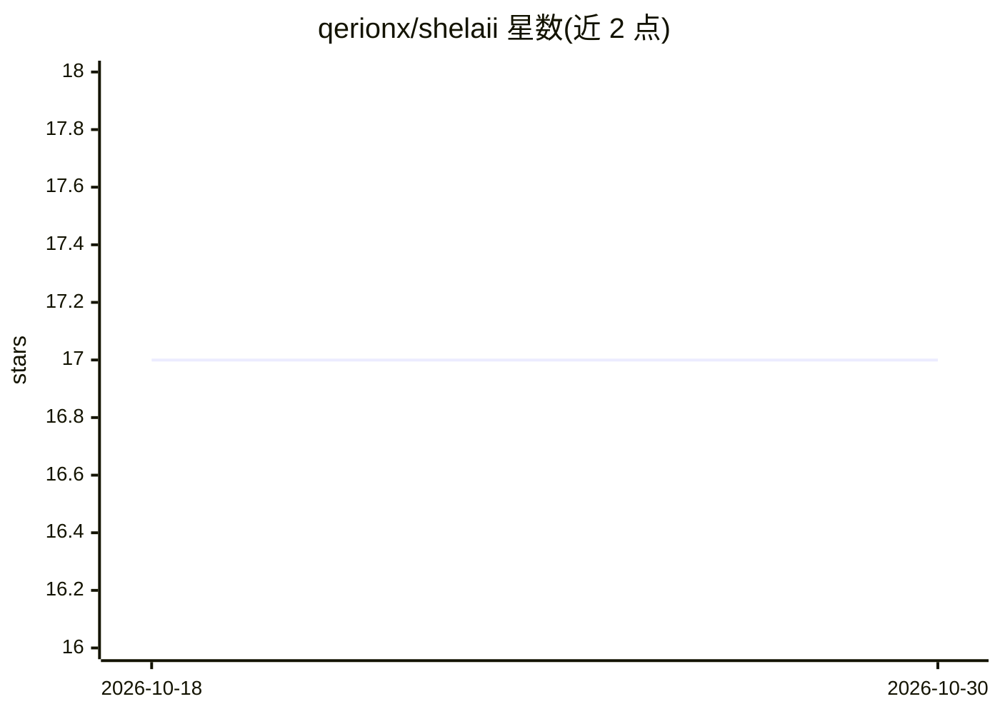

# qerionx/shelaii

⭐ 17 · Python · GPL-3.0 · 推送 2026-01-24 · [GitHub](https://github.com/qerionx/shelaii) · 个人维护

**命令行中调用 AI 模型对话的 Python CLI 工具**

用 Python 编写的终端程序，通过 G4F (GPT4Free) API 在控制台中与 AI 模型交互，无需 API key 即可获得回答。功能包括 CLI 直接对话与基于 rich 库的文本格式化界面。安装方式为 git clone 源码后安装依赖并运行 main.py，要求系统已装 Python3。支持文本交互，仓库主题标签含 image-generation。项目以 GPLv3 许可。

## 筛选速览

| 维度 | 判定 | 备注 |
|---|---|---|
| AI 角色 | `ai-native` | 本体是模型或模型工具 |
| 许可风险 | `viral` | GPL-3.0 |
| 部署形态 | `None` |  |
| 模型依赖 | — | README 未给出锁定关系 |
| 硬件要求 | — | 无带数字的原话,不猜 |
| 安装摩擦 | `low` | 无编译、无系统依赖或容器化 |
| 成熟度 | — | 结构信号不足 |

## 能力要点

- 基于 G4F (GPT4Free) API 的 CLI 对话
- 无需 API key
- rich 库的终端文本格式化

## 适用场景

- 在终端里直接向 AI 模型提问
- 不想注册 API key 时快速试用 AI 对话

## 场景标签

`聊天机器人` · 领域:对话与助手

## 证据(README 行号)

> L3: Shelaii is a CLI program made w/ Python that lets you interact with AI models in your console. The project uses the 
> L7: |Talk to the AI directly via CLI and receive responses based on your input.|

## 星数曲线

2026-10-18 17 → 2026-10-30 17（+0）

---
*卡片 v1 · prompt 1.4 · 生成 2026-10-29 · 置信度 high · 依据 README sha `713166b58fff` · [字段定义](../../DATASET.md)*
