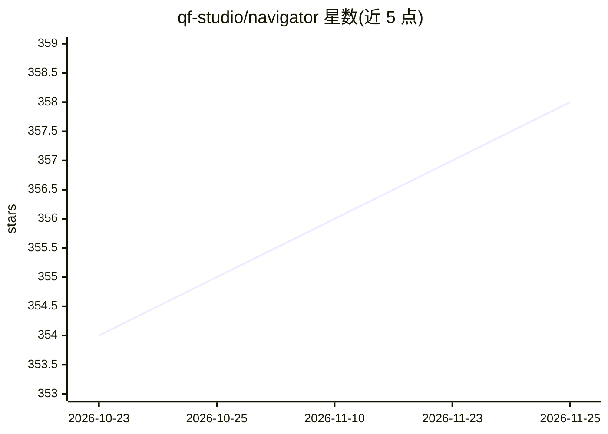

# qf-studio/navigator

⭐ 358 · Python · MIT · 推送 2026-11-16 · [GitHub](https://github.com/qf-studio/navigator) · [官网](https://quantflow.studio) · 组织维护

**为 Claude Code 开发者延长会话长度的上下文工程插件**

以 Claude Code 插件形式分发，按需加载文档以降低上下文占用，据其自述可将会话从 5-7 轮延长至 20+ 轮、节省约 92% token。核心机制包括：运行时强制的工作流（含 Python fallback）、/nav 实时面板（上下文占用、成本、token 速率等卡片）、知识图谱项目记忆、nav-profile 偏好记忆、Loop Mode 到完成即停、拒绝日志与 OpenTelemetry 指标。可选接入 TypeSafe typed judge（默认关闭，因提示词会发送到 API）与语言服务器插件；面板功能要求 Claude Code 2.1.287+。MIT 许可。

## 筛选速览

| 维度 | 判定 | 备注 |
|---|---|---|
| AI 角色 | `ai-ecosystem` | LLM/agent 周边工具 |
| 许可风险 | `permissive` | MIT |
| 部署形态 | `None` |  |
| 模型依赖 | — | README 未给出锁定关系 |
| 硬件要求 | — | 无带数字的原话,不猜 |
| 安装摩擦 | `low` | 无编译、无系统依赖或容器化 |
| 成熟度 | — | 结构信号不足 |

## 能力要点

- 按需加载上下文，README 自述节省 92% token、会话 20+ 轮
- /nav 面板显示上下文占用、成本、缓存命中率与下一步动作
- 知识图谱项目记忆与跨会话偏好记忆（nav-profile）
- Loop Mode 双条件退出与停滞检测，附拒绝日志

## 适用场景

- 长会话开发中避免上下文耗尽后重启重述
- 让 AI 跨会话记住项目知识与个人偏好
- 自动化执行『运行到完成』的开发任务

## 场景标签

`编码 Agent` `知识图谱` `Agent 记忆` · 领域:Agent 开发

## 证据(README 行号)

> L12: Navigator is a **Claude Code plugin** that implements context engineering for AI-assisted development.
> L92: Since v8 the workflow is enforced by a runtime that runs inside Claude Code, not by prose
> L110: without opening the pane. Requires Claude Code 2.1.287 or newer; older versions run the

## 星数曲线

2026-10-23 354 → 2026-11-25 358（+4）

---
*卡片 v1 · prompt 1.4 · 生成 2026-11-25 · 置信度 high · 依据 README sha `67375112f153` · [字段定义](../../DATASET.md)*
