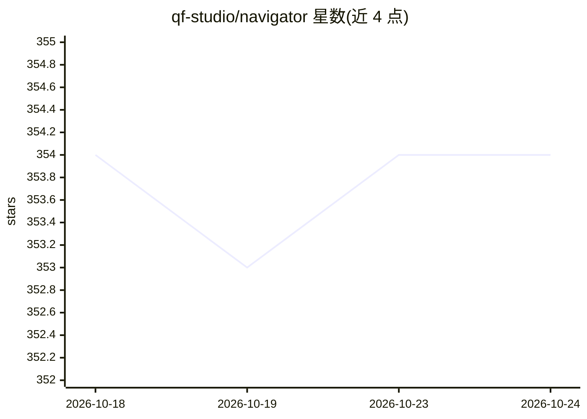

# qf-studio/navigator

⭐ 354 · Python · MIT · 推送 2026-10-20 · [GitHub](https://github.com/qf-studio/navigator) · [官网](https://quantflow.studio) · 组织维护

**给 Claude Code 用户的上下文工程插件：按需加载文档延长会话**

Claude Code 插件，实现上下文工程：按需加载所需文档而非一次性载入全部资料，以保持大部分上下文窗口可用于实际工作。提供自然语言技能自动调用、跨会话偏好记忆（nav-profile）、知识图谱项目记忆、Loop Mode 持续运行模式、/nav 实时面板与会话统计、OpenTelemetry 指标，以及由进程内运行时强制执行的工作流。需 Claude Code 2.1.275+ 安装、2.1.287+ 显示面板；Typed Prompt Judge 为可选功能且默认关闭。

## 筛选速览

| 维度 | 判定 | 备注 |
|---|---|---|
| AI 角色 | `ai-ecosystem` | LLM/agent 周边工具 |
| 许可风险 | `permissive` | MIT |
| 部署形态 | `None` |  |
| 模型依赖 | — | README 未给出锁定关系 |
| 硬件要求 | — | 无带数字的原话,不猜 |
| 安装摩擦 | `low` | 无编译、无系统依赖或容器化 |
| 成熟度 | — | 结构信号不足 |

## 能力要点

- 按需加载文档的上下文工程机制，宣称 20+ 轮会话与 92% token 节省（自报 OpenTelemetry 验证）
- 跨会话偏好记忆与知识图谱项目记忆
- v8 起由进程内运行时强制执行工作流，含 reject 日志
- /nav 实时面板展示上下文占用、成本与读取判定

## 适用场景

- 长会话开发中避免上下文耗尽导致的中途重启
- 让 Claude Code 按需查阅项目文档而非全量加载
- 跨会话保留个人偏好与项目决策记忆

## 场景标签

`编码 Agent` · 领域:编码与开发

## 证据(README 行号)

> L12: Navigator is a **Claude Code plugin** that implements context engineering for AI-assisted development.
> L92: Since v8 the workflow is enforced by a runtime that runs inside Claude Code, not by prose

## 星数曲线

2026-10-18 354 → 2026-10-24 354（+0）

---
*卡片 v1 · prompt 1.4 · 生成 2026-10-22 · 置信度 high · 依据 README sha `17006034f0dc` · [字段定义](../../DATASET.md)*
