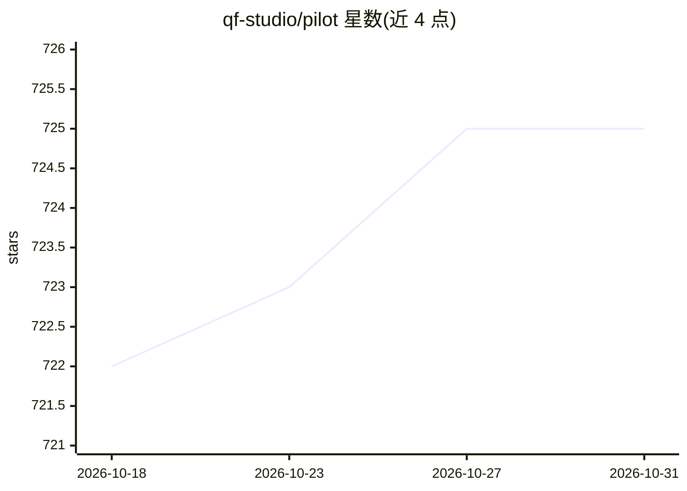

# qf-studio/pilot

⭐ 725 · Go · NOASSERTION · 推送 2026-10-30 · [GitHub](https://github.com/qf-studio/pilot) · [官网](https://pilot.quantflow.studio/) · 个人维护

**自动领取工单并完成代码的自主开发 agent**

从 GitHub/Linear/Jira/Asana 等工单源领取任务，由 Claude Code（或 OpenCode）作为执行后端规划实现、写代码、跑测试并开 PR，人审后合并。支持 Telegram 对话（聊天/研究/规划/任务四种模式）、TUI 仪表盘、CI 监控与自动合并、Haiku/Opus 模型路由、预算硬限制与 SQLite 持久化指标。CLI 以 Homebrew/Go/源码安装，另有 macOS/Windows/Linux 桌面应用。许可为 BSL 1.1。适合 bug 修复、小功能、重构等任务，不适用于大型架构变更。

## 筛选速览

| 维度 | 判定 | 备注 |
|---|---|---|
| AI 角色 | `ai-native` | 本体是模型或模型工具 |
| 许可风险 | `none` | NOASSERTION |
| 部署形态 | `desktop` | 安装包/桌面程序 |
| 模型依赖 | locked-api |  |
| 硬件要求 | — | 无带数字的原话,不猜 |
| 安装摩擦 | `medium` | 含编译或系统依赖之一 |
| 成熟度 | — | 结构信号不足 |

## 能力要点

- 从 GitHub/Linear/Jira/Asana 工单源领取任务并产出 PR
- Claude Code 与 OpenCode 双后端，Haiku/Opus 模型与努力程度自动路由
- Telegram 四种交互模式（聊天/提问/研究/规划/任务）
- 预算硬限制、质量门禁、执行回放与跨项目记忆

## 适用场景

- 让 AI 自动处理积压的 bug 修复和小功能工单
- 通过 Telegram 语音/文字下发开发任务并跟踪 PR
- 团队以预算上限控制自动化开发的 API 成本

## 场景标签

`编码 Agent` · 领域:编码与开发

## 证据(README 行号)

> L36: Pilot picks up tickets from GitHub, Linear, Jira, or Asana—plans the implementation, writes the code, runs tests, a
> L201: Pilot uses Claude Code for AI execution:

## 星数曲线

2026-10-18 722 → 2026-10-31 725（+3）

---
*卡片 v1 · prompt 1.4 · 生成 2026-10-21 · 置信度 high · 依据 README sha `7bfa16c6f23c` · [字段定义](../../DATASET.md)*
