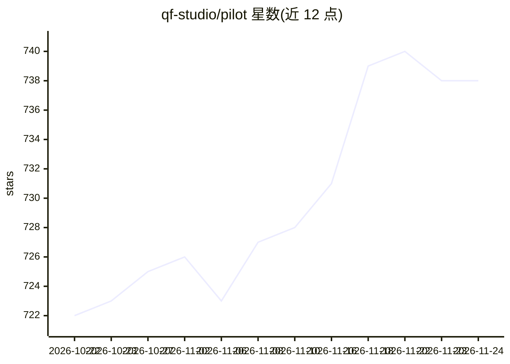

# qf-studio/pilot

⭐ 741 · Go · NOASSERTION · 推送 2026-11-23 · [GitHub](https://github.com/qf-studio/pilot) · [官网](https://docs.pilotcloud.dev) · 组织维护

**读取工单并自动写代码、开 PR 的自主开发代理**

Pilot 是一个以 Go 编写的自主编码代理：从 GitHub、Linear、Jira、Asana 拉取带标签的工单，规划实现、生成代码、运行测试并提交 PR，由人工审查合并。执行底层依赖 Claude Code CLI，支持模型按任务复杂度路由（Haiku/Opus）、质量门禁、成本预算控制、执行回放与跨项目记忆。提供 brew/go/源码安装及 macOS/Windows/Linux 桌面安装包，配套 TUI 仪表盘、Telegram 机器人与 Slack/Email 日报。许可为 BSL 1.1。

## 筛选速览

| 维度 | 判定 | 备注 |
|---|---|---|
| AI 角色 | `ai-native` | 本体是模型或模型工具 |
| 许可风险 | `none` | NOASSERTION |
| 部署形态 | `desktop` | 安装包/桌面程序 |
| 模型依赖 | locked-api |  |
| 硬件要求 | — | 无带数字的原话,不猜 |
| 安装摩擦 | `medium` | 含编译或系统依赖之一 |
| 成熟度 | — | 结构信号不足 |

## 能力要点

- 从 GitHub/Linear/Jira/Asana 自动拾取工单并生成 PR
- 模型路由：简单任务用 Haiku，复杂任务用 Opus，按复杂度映射思考深度
- 支持 Claude Code 与 OpenCode 双后端，BYOK 接入 Anthropic/Bedrock/Vertex
- 预算限额、成本告警与执行回放（HTML/JSON/MD 导出）

## 适用场景

- 积压工单自动化处理：bug 修复、小功能、重构、补测试
- 夜间无人值守地自动开发并在早晨审查合并 PR
- 通过 Telegram 与代理对话式规划、调研并派发任务
- 多仓库团队共享跨项目代码模式记忆

## 场景标签

`编码 Agent` · 领域:编码与开发

## 证据(README 行号)

> L36: Pilot picks up tickets from GitHub, Linear, Jira, or Asana—plans the implementation, writes the code, runs tests, a
> L201: Pilot uses Claude Code for AI execution:

## 星数曲线

2026-10-22 722 → 2026-11-24 738（+16）

---
*卡片 v1 · prompt 1.4 · 生成 2026-11-24 · 置信度 high · 依据 README sha `c9199ca765e0` · [字段定义](../../DATASET.md)*
