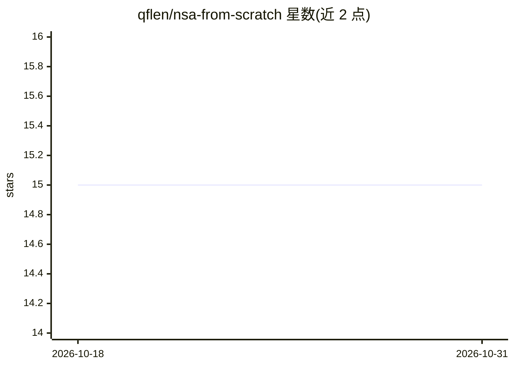

# qflen/nsa-from-scratch

⭐ 15 · Python · MIT · 推送 2026-06-21 · [GitHub](https://github.com/qflen/nsa-from-scratch) · [官网](https://github.com/qflen/nsa-from-scratch/blob/main/writeup/post.md) · 个人维护

**DeepSeek NSA 稀疏注意力的 Triton/CUDA 从零复现与评测**

对 DeepSeek 论文 Native Sparse Attention (arXiv:2502.11089) 的独立复现：三条分支（compressed/selected/sliding window）均实现为 Triton 内核，selected 分支另有基于 Hopper WGMMA inline-PTX 的 CUDA C++ 实现，支持 FP16/BF16/FP8 多精度，并手写 FA-2 风格的 selected 反向。附带五个模型的训练流程（FineWeb-Edu，32k–64k 上下文）、困惑度扫描（2k–256k）、LongBench v2 子集与 MoBA 交叉对比。吞吐基准需要 Hopper sm_90a 显卡；CPU-only 环境仅运行参考正确性测试。面向长上下文注意力机制研究与复现的开发者/科研用户。

## 筛选速览

| 维度 | 判定 | 备注 |
|---|---|---|
| AI 角色 | `ai-native` | 本体是模型或模型工具 |
| 许可风险 | `permissive` | MIT |
| 部署形态 | `library` | 以包/库形式分发 |
| 模型依赖 | — | README 未给出锁定关系 |
| 硬件要求 | — | 无带数字的原话,不猜 |
| 安装摩擦 | `medium` | 含编译或系统依赖之一 |
| 成熟度 | — | 结构信号不足 |

## 能力要点

- 三条 NSA 分支的 Triton 内核 + Hopper WGMMA CUDA C++ 实现
- FP16/BF16/FP8 多精度与 48 配置 autotune
- 五模型训练流程与 2k–256k 困惑度评测
- 与 FlashAttention-3、MoBA 的同基准对比

## 适用场景

- 复现 NSA 论文的内核实现与基准结果
- 研究长上下文稀疏注意力机制并训练自己的模型
- 对比稀疏注意力与稠密注意力的吞吐与质量

## 场景标签

`模型训练` `科研工具` · 领域:学习与行业

## 证据(README 行号)

> L11: From-scratch reimplementation of DeepSeek's Native Sparse Attention (Yuan et al., February 2025, arXiv:2502.11089):
> L28: - All three NSA branches (compressed, selected, sliding window) as Triton kernels.

## 星数曲线

2026-10-18 15 → 2026-10-31 15（+0）

---
*卡片 v1 · prompt 1.4 · 生成 2026-10-30 · 置信度 high · 依据 README sha `bead1fc2208d` · [字段定义](../../DATASET.md)*
