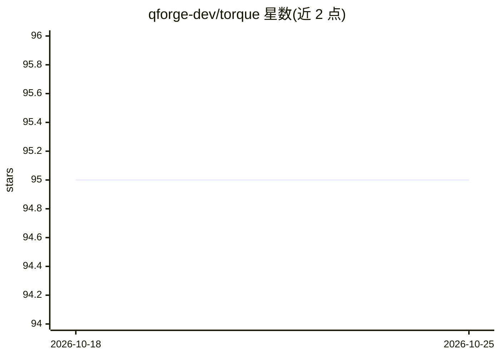

# qforge-dev/torque

⭐ 95 · TypeScript · MIT · 推送 2025-11-19 · [GitHub](https://github.com/qforge-dev/torque) · [官网](https://www.npmjs.com/package/@qforge/torque) · 组织维护

**类型安全的声明式 DSL：用组件式组合构建 LLM 合成数据集**

TypeScript 库，以类 React 组件的方式声明式组合对话 schema，生成 LLM 合成训练数据集。通过 AI SDK 生态接入任意 provider 生成内容，内置 Faker.js 与种子同步机制保证可复现，支持 oneOf 加权选择、uniqueBy 唯一抽取、Zod 类型安全的工具定义与两阶段（检查/生成）执行。输出支持 JSONL/Parquet 文件格式与 ai-sdk/chat_template（OpenAI Chat Completions 兼容）数据结构，可增量写出大文件；Token 计数在 worker 线程池后台执行。面向需要批量构造微调/训练数据的开发者。

## 筛选速览

| 维度 | 判定 | 备注 |
|---|---|---|
| AI 角色 | `ai-ecosystem` | LLM/agent 周边工具 |
| 许可风险 | `permissive` | MIT |
| 部署形态 | `library` | 以包/库形式分发 |
| 模型依赖 | — | README 未给出锁定关系 |
| 硬件要求 | — | 无带数字的原话,不猜 |
| 安装摩擦 | `low` | 无编译、无系统依赖或容器化 |
| 成熟度 | — | 结构信号不足 |

## 能力要点

- 类 React 组件式组合对话 schema，Zod 完整类型推断
- seed 驱动的可复现生成（含 Faker 假数据与确定性行 ID）
- 两阶段执行：先检查结构再 AI 填充内容，支持并发生成与实时进度
- 输出 JSONL/Parquet，exportFormat 兼容 ai-sdk 与 OpenAI Chat Completions 格式

## 适用场景

- 批量生成带工具调用序列的微调数据集
- 在真实数据不足时构造可复现的合成对话训练数据
- 为不同模型 provider 生成变体多样的对话数据

## 场景标签

 · 领域:LLM 数据工程

## 证据(README 行号)

> L3: **Torque** is a declarative, fully typesafe DSL for quickly building complex LLM synthetic datasets. Compose convers
> L14: - **🔌 Provider Agnostic** - Generate with any AI SDK provider (OpenAI, Anthropic, DeepSeek, vLLM, LLaMA.cpp etc.)
> L263: - **`ai-sdk`** (default) - Internal Torque format, compatible with Vercel AI SDK. Includes schema metadata, tool d

## 星数曲线

2026-10-18 95 → 2026-10-25 95（+0）

---
*卡片 v1 · prompt 1.4 · 生成 2026-10-23 · 置信度 high · 依据 README sha `561eed54672b` · [字段定义](../../DATASET.md)*
