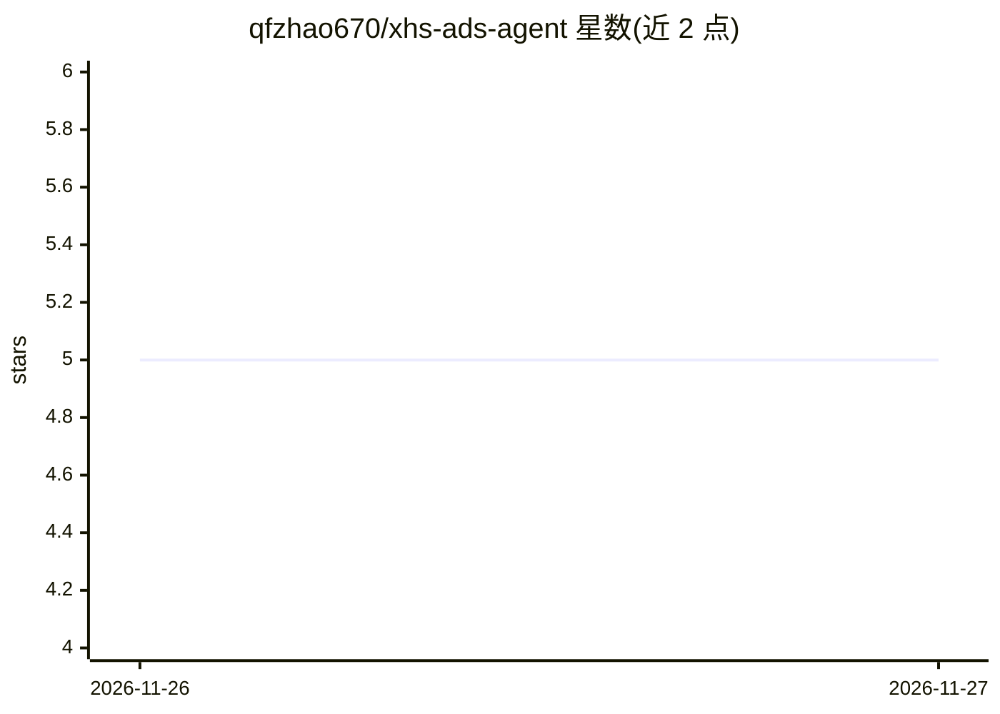

# qfzhao670/xhs-ads-agent

⭐ 5 · JavaScript · 推送 2026-11-26 · [GitHub](https://github.com/qfzhao670/xhs-ads-agent) · 个人维护 · 中文 README

**本地优先的小红书图文内容生成桌面工作台**

面向小红书运营者的桌面应用：将业务素材、关键词、参考文案、合规准则与图片分层沉淀为项目级素材库，按「核对事实→微选题→生成文案→双路线配图→入库避重」流程生产内容。文案走 Chat Completions 兼容接口并要求结构化 JSON 输出，配图支持参考样本 AI 套图与业务实拍排版两条路线。项目数据以 JSON/Markdown/图片文件保存在本地文件夹，用户自行配置模型接口地址与 API Key。Windows 安装包通过 GitHub Actions 构建发布。

## 筛选速览

| 维度 | 判定 | 备注 |
|---|---|---|
| AI 角色 | `ai-native` | 本体是模型或模型工具 |
| 许可风险 | `none` | — |
| 部署形态 | `None` |  |
| 模型依赖 | — | README 未给出锁定关系 |
| 硬件要求 | — | 无带数字的原话,不猜 |
| 安装摩擦 | `low` | 无编译、无系统依赖或容器化 |
| 成熟度 | — | 结构信号不足 |

## 能力要点

- 事实提取与冲突口径人工确认后再进入创作
- 微选题拆分与按模式分池的终稿避重机制
- AI 套图与实拍宣传图双配图路线，含手动排版编辑器
- 项目资产以本地文件保存，支持备份、同步与跨项目迁移

## 适用场景

- 长期运营小红书账号时沉淀可复用的内容资产
- 为同一业务批量产出互不重复的多篇笔记文案与配图
- 团队内按合规准则约束营销文案表达

## 场景标签

`AI 写作` `图像生成` · 领域:内容生成

## 证据(README 行号)

> L9:  一款本地优先的桌面工作台，覆盖素材沉淀、事实核对、选题策略、文案修订、双路线配图与终稿避重。
> L133: ### 3. 生成文案，保留每一次修订
> L229: |AI 套图与实拍 AI 装饰（可选）|支持图生图的图片模型；内置 DashScope Qwen Image 与 OpenAI 兼容协议配置。|

## 星数曲线

2026-11-26 5 → 2026-11-27 5（+0）

---
*卡片 v1 · prompt 1.4 · 生成 2026-11-26 · 置信度 high · 依据 README sha `294bd2180414` · [字段定义](../../DATASET.md)*
