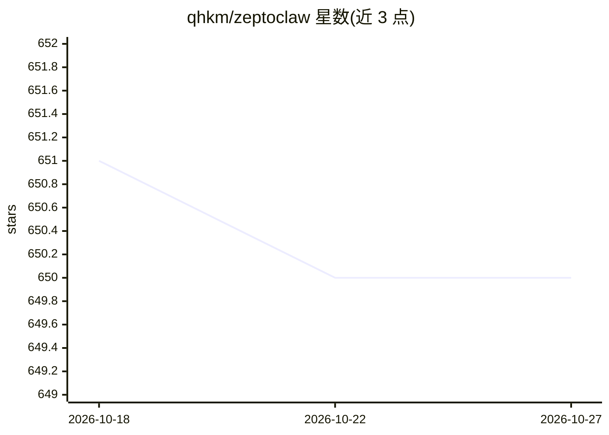

# qhkm/zeptoclaw

⭐ 650 · Rust · Apache-2.0 · 推送 2026-10-18 · [GitHub](https://github.com/qhkm/zeptoclaw) · [官网](https://zeptoclaw.com/) · 组织维护

**单个 Rust 二进制的本地优先个人 AI 助手基础设施**

以约 6MB 的单个 Rust 二进制在本地、边缘设备或 VPS 上运行个人 AI agent，内置 33 个工具与插件系统、记忆、10+ 消息通道（Telegram/Slack/Discord/WhatsApp 等）和 18 家 LLM 提供商接入。安全方面默认启用 6 种沙箱运行时（Docker/Landlock/Firejail/Bubblewrap 等）、提示注入检测、密钥泄露扫描、策略引擎与 SSRF 防护，并提供从 OpenClaw 一键迁移、多租户部署与 Prometheus 监控。控制面板为编译期可选功能，需自行 build --features panel。由 Aisar Labs 维护，Apache 2.0 许可，另提供商业授权咨询入口。

## 筛选速览

| 维度 | 判定 | 备注 |
|---|---|---|
| AI 角色 | `ai-native` | 本体是模型或模型工具 |
| 许可风险 | `permissive` | Apache-2.0 |
| 部署形态 | `None` |  |
| 模型依赖 | local-ok | 支持本地模型 |
| 硬件要求 | — | 无带数字的原话,不猜 |
| 安装摩擦 | `low` | 无编译、无系统依赖或容器化 |
| 成熟度 | — | 结构信号不足 |

## 能力要点

- 约 6MB 单二进制，18 家 LLM 提供商，SSE 流式与自动故障转移
- 6 种沙箱运行时与提示注入检测、密钥泄露扫描等默认启用的安全层
- 33 个内置工具、插件系统、Agent Swarms 子代理并行委派
- OpenClaw 配置与技能一键迁移，支持多租户单 VPS 部署

## 适用场景

- 在本地或 VPS 上自托管个人 AI 助手并通过 Telegram/Slack 等通道使用
- 在低配置/边缘硬件上运行沙箱隔离的代码执行 agent
- 从 OpenClaw 迁移现有配置、技能与通道设置

## 场景标签

`AI 助手` · 领域:对话与助手

## 证据(README 行号)

> L19: ZeptoClaw is one Rust binary for running personal AI agents locally, at the edge, or on a VPS — with tools, memory,
> L258: |**ZeptoClaw**|qhkm/zeptoclaw|Personal AI assistant infrastructure — tools, memory, providers, channels, sandboxed

## 星数曲线

2026-10-18 651 → 2026-10-27 650（-1）

---
*卡片 v1 · prompt 1.4 · 生成 2026-10-21 · 置信度 high · 依据 README sha `62599149346a` · [字段定义](../../DATASET.md)*
