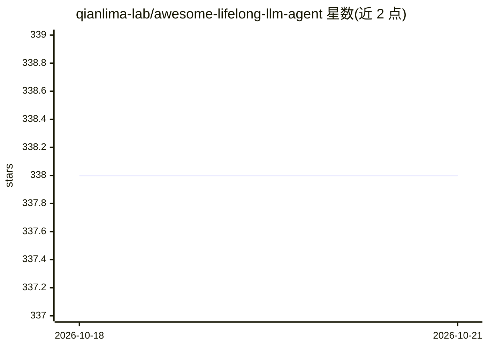

# qianlima-lab/awesome-lifelong-llm-agent

⭐ 339 · Python · 推送 2026-10-01 · [GitHub](https://github.com/qianlima-lab/awesome-lifelong-llm-agent) · [官网](https://arxiv.org/abs/2501.07278) · 组织维护 · 中文 README

**LLM Agent 终身学习综述配套论文清单：感知/记忆/行动三模块组织**

TPAMI 2026 综述论文 'Lifelong Learning of LLM based Agents: A Roadmap' 的配套仓库，按论文提出的 Perception、Memory、Action 三大模块收录终身学习（ continual/incremental learning）相关论文，细分单模态/多模态感知、工作/情景/语义/参数记忆、接地/检索/推理行动等子类，每条含标题、发表会议与日期。面向终身学习方向的研究者，提供中英文 README；新增论文通过更新 assets/paper.json 完成。另提及 2025 年发布基准 LifelongAgentBench。仓库本身不含可运行代码。

## 筛选速览

| 维度 | 判定 | 备注 |
|---|---|---|
| AI 角色 | `ai-knowledge` | 知识聚合/清单类 |
| 许可风险 | `none` | — |
| 部署形态 | `None` |  |
| 模型依赖 | — | README 未给出锁定关系 |
| 硬件要求 | — | 无带数字的原话,不猜 |
| 安装摩擦 | `low` | 无编译、无系统依赖或容器化 |
| 成熟度 | — | 结构信号不足 |

## 能力要点

- 按感知/记忆/行动三模块的论文分类组织
- 配套 TPAMI 2026 综述论文，提供中英文 README
- 子类覆盖单/多模态感知、四类记忆、三类行动共约十余个方向

## 适用场景

- 查找 LLM Agent 终身学习各子方向的代表性论文
- 按模块框架了解终身学习研究的整体路线图
- 跟进情景记忆、参数记忆等记忆机制方向的文献

## 场景标签

`科研工具` `精选清单` · 领域:学习与行业

## 证据(README 行号)

> L5: Welcome to the repository accompanying our survey paper on **Lifelong Learning of Large Language Model based Agents:
> L11: - **2025.06**: We are excited to release the first benchmark LifelongAgentBench for lifelong learning of LLM Agents

## 星数曲线

2026-10-18 338 → 2026-10-21 338（+0）

---
*卡片 v1 · prompt 1.4 · 生成 2026-10-22 · 置信度 high · 依据 README sha `515dfdf67734` · [字段定义](../../DATASET.md)*
