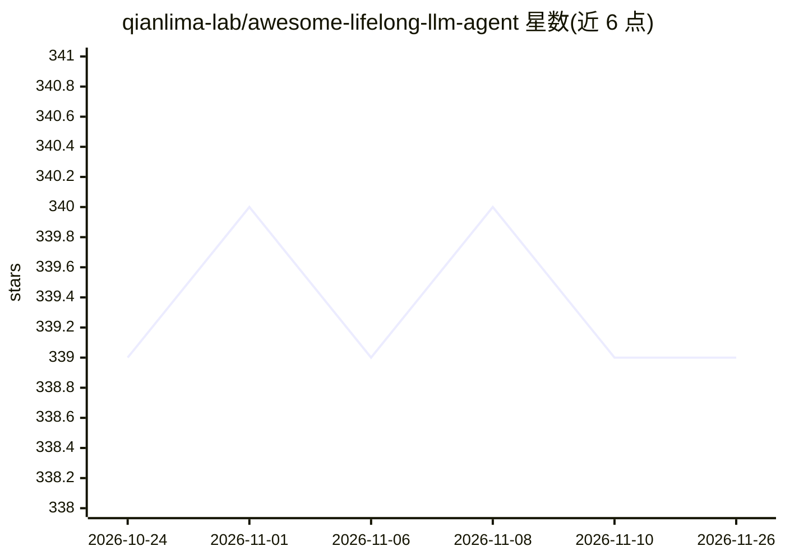

# qianlima-lab/awesome-lifelong-llm-agent

⭐ 339 · Python · 推送 2026-11-22 · [GitHub](https://github.com/qianlima-lab/awesome-lifelong-llm-agent) · [官网](https://arxiv.org/abs/2501.07278) · 组织维护 · 中文 README

**为 LLM agent 终身学习研究提供论文与资源清单**

配套综述论文《Lifelong Learning of Large Language Model based Agents: A Roadmap》（已被 IEEE TPAMI 接收）的论文集合仓库。按 Perception、Memory、Action 三个模块组织收录的论文，Memory 下再分工作记忆、情景记忆、语义记忆与参数记忆等子类，Action 下覆盖工具、Web、游戏环境及检索与推理类论文。条目以表格形式给出标题、发表场合与日期，收录工作含 ReAct、Reflexion、ToolLLM、Voyager 等，并提示通过 assets/paper.json 提交新论文，附中文版 README 与引用信息。

## 筛选速览

| 维度 | 判定 | 备注 |
|---|---|---|
| AI 角色 | `ai-knowledge` | 知识聚合/清单类 |
| 许可风险 | `none` | — |
| 部署形态 | `None` |  |
| 模型依赖 | — | README 未给出锁定关系 |
| 硬件要求 | — | 无带数字的原话,不猜 |
| 安装摩擦 | `low` | 无编译、无系统依赖或容器化 |
| 成熟度 | — | 结构信号不足 |

## 能力要点

- 按感知/记忆/行动三模块组织论文清单，下设多个子类
- 收录 ReAct、Reflexion、ToolLLM、Voyager 等 LLM agent 相关论文，附 venue 与日期
- 提供配套 benchmark LifelongAgentBench 的论文、代码与数据集链接
- 提供中文版 README 与 BibTeX 引用条目

## 适用场景

- 调研 LLM agent 终身学习/持续学习方向的相关工作
- 按感知、记忆、行动模块查找对应研究论文
- 追踪持续学习、增量学习与知识编辑方向的进展

## 场景标签

`精选清单` · 领域:学习与行业

## 证据(README 行号)

> L5: Welcome to the repository accompanying our survey paper on **Lifelong Learning of Large Language Model based Agents:
> L11: - **2025.06**: We are excited to release the first benchmark LifelongAgentBench for lifelong learning of LLM Agents
> L21: ## 📒 Table of Contents

## 星数曲线

2026-10-24 339 → 2026-11-26 339（+0）

---
*卡片 v1 · prompt 1.4 · 生成 2026-11-25 · 置信度 high · 依据 README sha `edeb68a3a330` · [字段定义](../../DATASET.md)*
