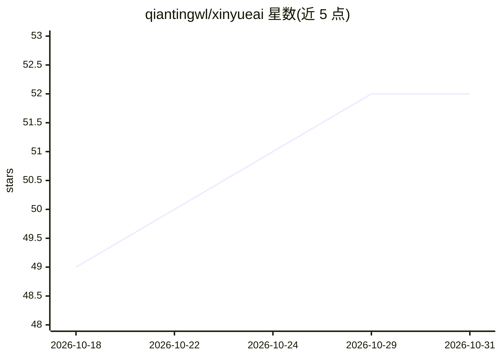

# qiantingwl/xinyueai

⭐ 52 · TypeScript · 推送 2026-10-11 · [GitHub](https://github.com/qiantingwl/xinyueai) · 组织维护 · 中文 README

**可自托管的 AI 创作与模型管理平台：多模型对话与图片/视频生成**

面向需要自托管 AI 平台的团队与个人，用 Vue 3 + NestJS 构建的创作与模型管理系统：多模型流式对话（附件、分支、引用、共享链接）、无限画布、图片/视频/商品视觉生成、PPT/文档/表格导出、12 个内置助手与 14 个预装技能、6 类知识库模板。模型网关支持 OpenAI Compatible、Anthropic、Gemini、NewAPI、Sub2API、Pollinations 及本地 Worker 协议，含 BYOK、渠道健康检查与 Token 计费。Docker 一键部署，附带管理后台、订阅支付与审核。

## 筛选速览

| 维度 | 判定 | 备注 |
|---|---|---|
| AI 角色 | `ai-native` | 本体是模型或模型工具 |
| 许可风险 | `none` | — |
| 部署形态 | `self-host` | docker 或自建部署 |
| 模型依赖 | — | README 未给出锁定关系 |
| 硬件要求 | — | 无带数字的原话,不猜 |
| 安装摩擦 | `low` | 无编译、无系统依赖或容器化 |
| 成熟度 | — | 结构信号不足 |

## 能力要点

- 多模型网关：多协议、健康检查、冷却熔断、BYOK 与 Token 计费
- 无限画布（Vue Flow）与图片/视频/商品视觉生成
- PPT、文档、表格生成，可导出 PPTX / DOCX / XLSX
- Docker 一键部署：install.sh 自动启动 PostgreSQL、Redis、后端与前端

## 适用场景

- 团队或个人自托管一个多模型 AI 对话与创作平台
- 通过网关统一管理多个上游模型渠道并做额度计费
- 用画布和预装技能生成图片、图表、PPT 等办公产出

## 场景标签

`模型网关` `图像生成` `视频生成` `聊天机器人` · 领域:Agent 开发

## 证据(README 行号)

> L8:  开源、可自托管的 AI 创作与模型管理平台
> L19: - **平台**：模型网关（多协议、健康检查、BYOK、Token 计费）、团队空间、订阅支付、完整管理后台
> L28: - 多模型流式对话：思考过程、联网搜索与引用、分支、临时聊天、附件、追问建议、共享链接

## 星数曲线

2026-10-18 49 → 2026-10-31 52（+3）

---
*卡片 v1 · prompt 1.4 · 生成 2026-10-24 · 置信度 high · 依据 README sha `b46e01577a5f` · [字段定义](../../DATASET.md)*
