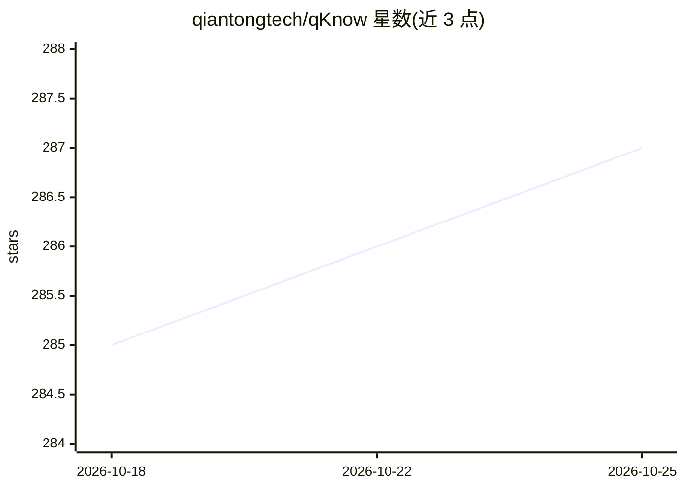

# qiantongtech/qKnow

⭐ 287 · Java · NOASSERTION · 推送 2026-10-16 · [GitHub](https://github.com/qiantongtech/qKnow) · [官网](https://community.qknow.ai/) · 组织维护 · 中文 README

**企业知识智能与行业 AI 应用构建平台**

面向企业知识智能化场景的开源 AI 智能体构建平台，围绕知识图谱与知识库 RAG 双引擎提供知识抽取、建模、智能问答、Bot 构建与可视化编排（拖拽式画布编排 Workflow/Chatflow/Agent），将行业 AI 能力封装为标准化插件模块。后端为 JDK 17 + Spring Boot 3 + Spring AI，前端 Vue 3，依赖 MySQL、Neo4j、Weaviate、Redis；提供 Docker Compose 一键部署与手工部署两种方式，另设专业版商用授权，适合 Java 技术团队私有化部署与二次开发。

## 筛选速览

| 维度 | 判定 | 备注 |
|---|---|---|
| AI 角色 | `ai-ecosystem` | LLM/agent 周边工具 |
| 许可风险 | `none` | NOASSERTION |
| 部署形态 | `self-host` | docker 或自建部署 |
| 模型依赖 | — | README 未给出锁定关系 |
| 硬件要求 | — | 无带数字的原话,不猜 |
| 安装摩擦 | `low` | 无编译、无系统依赖或容器化 |
| 成熟度 | — | 结构信号不足 |

## 能力要点

- 知识图谱 + RAG 双引擎：结构化知识建模与非结构化文档检索并存
- 可视化编排：拖拽画布编排 Workflow、Chatflow 与 Agent
- 基于统一插件架构的知识问答应用接入与扩展
- 从文档/数据库自动抽取实体、关系、三元组构建图谱

## 适用场景

- 搭建企业知识库问答助手与内部制度/手册问答系统
- 构建知识图谱驱动的可解释智能检索应用
- 沉淀企业文档、结构化数据与专家经验为知识资产
- Java 团队私有化部署并二次开发行业 AI 应用

## 场景标签

`文档问答` `知识图谱` `RAG` `Agent 框架` · 领域:Agent 开发

## 证据(README 行号)

> L13: **qKnow** 是一套面向企业**知识智能化**与**行业 AI 应用**场景的开源 AI 智能体构建平台，围绕**知识图谱**、**知识库 RAG**、**Bot 构建**与**开箱即用的 AI 应用**等核心能力，平台将行
> L41: |🤖 面向企业的 Agent 构建|支持 Bot 创建、调试、发布与应用配置，帮助企业快速搭建可落地的业务智能体。|
> L44: |🔌 开放模型接入|基于 Spring AI 接入大模型能力，便于适配不同模型服务与企业内部模型环境。|

## 星数曲线

2026-10-18 285 → 2026-10-25 287（+2）

---
*卡片 v1 · prompt 1.4 · 生成 2026-10-22 · 置信度 high · 依据 README sha `81b3d6eaf200` · [字段定义](../../DATASET.md)*
