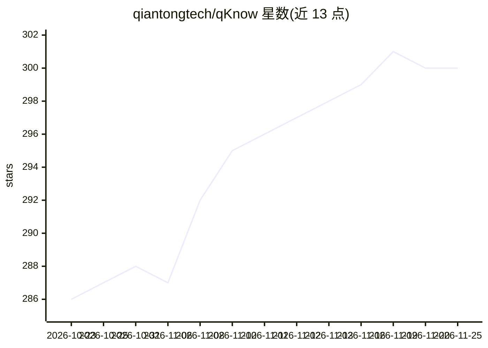

# qiantongtech/qKnow

⭐ 300 · Java · NOASSERTION · 推送 2026-11-17 · [GitHub](https://github.com/qiantongtech/qKnow) · [官网](https://community.qknow.ai/) · 组织维护 · 中文 README

**面向企业的开源智能体构建平台：知识图谱+RAG+Bot**

qKnow 是一套前后端分离的企业知识智能化平台，后端 JDK 17 + Spring Boot 3、前端 Vue 3，通过 Spring AI 接入大模型。功能覆盖知识图谱构建（实体/关系/三元组抽取、图谱可视化）、知识库 RAG 问答（文件解析、召回测试）、Bot 创建/调试/发布及拖拽式 Workflow/Chatflow 编排。提供开源版与专业版两种形态；部署支持 Docker Compose 一键启动或依赖组件手工安装（需 MySQL、Neo4j、Weaviate、Redis 等）。

## 筛选速览

| 维度 | 判定 | 备注 |
|---|---|---|
| AI 角色 | `ai-ecosystem` | LLM/agent 周边工具 |
| 许可风险 | `none` | NOASSERTION |
| 部署形态 | `self-host` | docker 或自建部署 |
| 模型依赖 | — | README 未给出锁定关系 |
| 硬件要求 | — | 无带数字的原话,不猜 |
| 安装摩擦 | `low` | 无编译、无系统依赖或容器化 |
| 成熟度 | — | 结构信号不足 |

## 能力要点

- 知识图谱 + RAG 双引擎：结构化知识建模与非结构化文档检索并行
- 拖拽式画布编排 Workflow、Chatflow 与 Agent
- 基于 Spring AI 接入不同模型厂商，适配企业内部模型环境
- 从数据库、表格等结构化数据源抽取知识元素构建图谱

## 适用场景

- 搭建企业内部制度、标准、手册的问答系统
- 构建行业专家智能体与业务流程 Bot
- 将文档和业务数据沉淀为可复用知识图谱资产
- 在 Java 技术团队内做二次开发与私有化部署

## 场景标签

`知识图谱` `RAG` `文档问答` · 领域:知识与检索

## 证据(README 行号)

> L13: **qKnow** 是一套面向企业**知识智能化**与**行业 AI 应用**场景的开源 AI 智能体构建平台，围绕**知识图谱**、**知识库 RAG**、**Bot 构建**与**开箱即用的 AI 应用**等核心能力，平台将行
> L69: |模型接入|支持统一配置和管理大模型服务，基于 Spring AI 接入不同模型厂商，为智能体和应用提供模型能力。|
> L173: |Docker Compose 部署|所有组件（DeepKE、Neo4j、Mysql、Nginx、Redis 等）以及 qKnow 源码都通过 Docker Compose 一键启动|**初学者快速上手**、功能演示、测试环境|

## 星数曲线

2026-10-23 286 → 2026-11-25 300（+14）

---
*卡片 v1 · prompt 1.4 · 生成 2026-11-25 · 置信度 high · 依据 README sha `9d4979a11760` · [字段定义](../../DATASET.md)*
