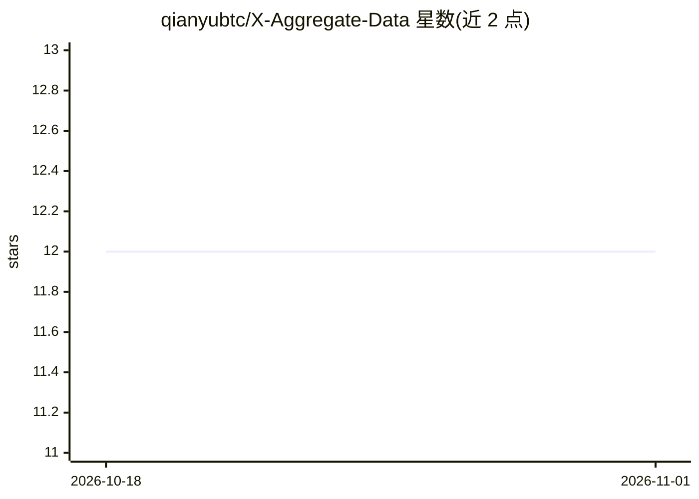

# qianyubtc/X-Aggregate-Data

⭐ 12 · Python · MIT · 推送 2026-10-14 · [GitHub](https://github.com/qianyubtc/X-Aggregate-Data) · [官网](https://lanbuzhu.org) · 个人维护 · 中文 README

**让 AI Agent 免 API 读取 X/Twitter 数据的 Agent Skill**

面向 Claude Code、Codex 等支持 Agent Skills 的 Agent 的技能包：通过本地 Python 脚本（仅标准库、零依赖）调用 FxTwitter 公开接口与蓝不住 lanbuzhu.org 开放接口，返回结构化 JSON。覆盖推文/回复/搜索/账号/时间线/关注列表/翻译，以及 X 中文区账号统计、排行、日报、大V动态、谣言库。不需要 X 账号或 API Key；限制包括：锁推内容拿不到、接口有频率限制（中文区统计每 IP 每分钟 60 次）。含提示注入防护（去除控制字符、要求 Agent 把推文当数据）。

## 筛选速览

| 维度 | 判定 | 备注 |
|---|---|---|
| AI 角色 | `ai-ecosystem` | LLM/agent 周边工具 |
| 许可风险 | `permissive` | MIT |
| 部署形态 | `library` | 以包/库形式分发 |
| 模型依赖 | — | README 未给出锁定关系 |
| 硬件要求 | — | 无带数字的原话,不猜 |
| 安装摩擦 | `low` | 无编译、无系统依赖或容器化 |
| 成熟度 | — | 结构信号不足 |

## 能力要点

- 免 X API/登录，本地脚本直连 FxTwitter 与蓝不住接口，返回结构化 JSON
- 覆盖推文/thread/回复/搜索/账号/时间线/关注列表/翻译等实时数据
- X 中文区统计：逐日数据、排行、每日冠军、大V删帖/改名/粉丝异动动态
- 提示注入防护：过滤 Unicode 控制字符并声明推文内容非指令

## 适用场景

- 让 Claude Code/Codex 直接研究 X 上的账号、推文和话题
- 获取中文区账号的曝光/涨粉排行与每日统计
- 在自己程序里通过命令行调用获取推文 JSON 数据

## 场景标签

`网页抓取` · 领域:效率与自动化

## 证据(README 行号)

> L22: **X-Aggregate-Data** 是一个 Agent Skill：装上之后，Agent 遇到 X 的链接、账号或话题，会自己调用一个本地脚本，在 1–3 秒内拿回**结构化的原始数据**——正文、发布时间、浏览、点赞、转发
> L43: |Agent|支持 Agent Skills 的 Agent，如 Claude Code、Codex；其他 Agent 或脚本也可以直接调用命令行|

## 星数曲线

2026-10-18 12 → 2026-11-01 12（+0）

---
*卡片 v1 · prompt 1.4 · 生成 2026-11-01 · 置信度 high · 依据 README sha `ae298f8271c7` · [字段定义](../../DATASET.md)*
