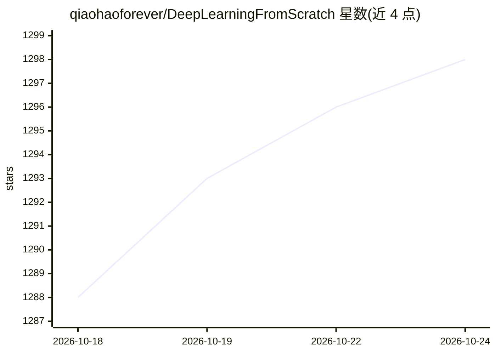

# qiaohaoforever/DeepLearningFromScratch

⭐ 1,300 · Python · MIT · 推送 2025-11-29 · [GitHub](https://github.com/qiaohaoforever/DeepLearningFromScratch) · 个人维护 · 中文 README

**《深度学习入门》书籍配套源代码与电子版仓库**

收录《深度学习入门：基于Python的理论与实现》的电子版及各章配套源代码，按 ch01-ch08 章节组织，另含 common 公共模块与 dataset 数据集代码。运行需 Python 3.x、NumPy、Matplotlib，进入章节目录执行 python 脚本即可，源码解释以书中内容为准。源代码采用 MIT 许可，商业使用亦被许可，并附图灵社区勘误表链接。

## 筛选速览

| 维度 | 判定 | 备注 |
|---|---|---|
| AI 角色 | `ai-knowledge` | 知识聚合/清单类 |
| 许可风险 | `permissive` | MIT |
| 部署形态 | `None` |  |
| 模型依赖 | — | README 未给出锁定关系 |
| 硬件要求 | — | 无带数字的原话,不猜 |
| 安装摩擦 | `low` | 无编译、无系统依赖或容器化 |
| 成熟度 | — | 结构信号不足 |

## 能力要点

- ch01-ch08 各章配套源代码与 common/dataset 公共模块
- 运行依赖仅 Python 3.x / NumPy / Matplotlib
- MIT 许可，允许商业与非商业使用

## 适用场景

- 随书学习深度学习并运行各章示例代码
- 查看从零实现神经网络的 Python 代码结构

## 场景标签

`教程课程` · 领域:学习与行业

## 证据(README 行号)

> L1: # 深度学习入门
> L11: |ch01|第1章使用的源代码|

## 星数曲线

2026-10-18 1,288 → 2026-10-24 1,298（+10）

---
*卡片 v1 · prompt 1.4 · 生成 2026-10-21 · 置信度 high · 依据 README sha `de1ce6384124` · [字段定义](../../DATASET.md)*
