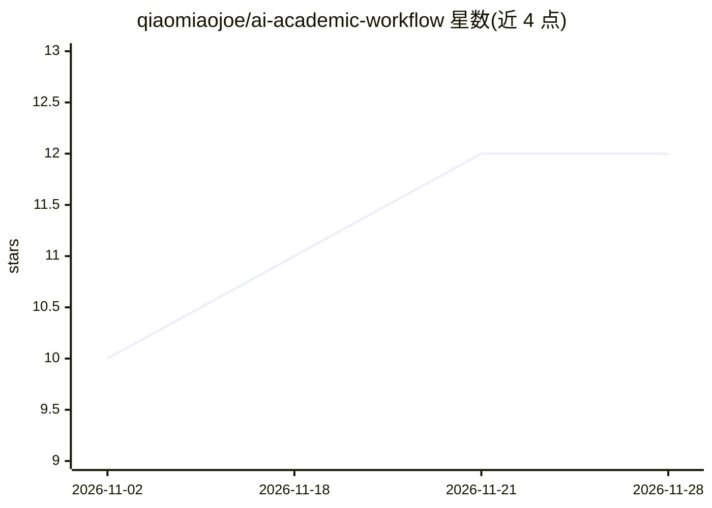

# qiaomiaojoe/ai-academic-workflow

⭐ 12 · JavaScript · NOASSERTION · 推送 2026-11-22 · [GitHub](https://github.com/qiaomiaojoe/ai-academic-workflow) · 个人维护 · 中文 README

**面向学术研究者的 48 个 AI 学术工作流 skills 库**

为「AI学术训练营」学员整理的 skills 库，按期刊初稿、综述文章、投稿与审稿三条工作流组织 48 个 skills，覆盖选题、文献检索与验真、研究设计、数据分析、写作、改稿、投稿与返修各阶段。每个 skill 由方法依据、可执行指令与人工确认节点三层拼装，设置不编造文献、验真零容忍、checkpoint 必停等硬约束。运行于 Claude Code / Codex；文献检索、Zotero 入库、docx 转换依赖 Node.js、pandoc 等外部工具，未装时按表降级运行。

## 筛选速览

| 维度 | 判定 | 备注 |
|---|---|---|
| AI 角色 | `ai-knowledge` | 知识聚合/清单类 |
| 许可风险 | `none` | NOASSERTION |
| 部署形态 | `None` |  |
| 模型依赖 | — | README 未给出锁定关系 |
| 硬件要求 | — | 无带数字的原话,不猜 |
| 安装摩擦 | `low` | 无编译、无系统依赖或容器化 |
| 成熟度 | — | 结构信号不足 |

## 能力要点

- 48 个 skills 按工作流→阶段→skill 组织，可整段运行或单独运行某一步
- 硬约束写死：不编造文献（[TBD-citation] 占位）、验真零容忍、每阶段 checkpoint 停下等作者拍板
- 自带 cnki/journal-rank/scholar/openalex 检索脚本与 Zotero 入库流程
- 18 个定量/定性分析 prompt 可脱离 skills 直接复制使用

## 适用场景

- 从选题到全文初稿推进一篇研究性论文
- 完成系统/叙事/整合式综述的检索、综合与成文
- 诊断初稿、核对期刊要求、整理投稿包并撰写逐条返修回复

## 场景标签

`科研工具` `AI 写作` `数据分析` · 领域:效率与自动化

## 证据(README 行号)

> L3: > 「**AI学术训练营**」（乔淼PhD）配套的 **AI学术工作流** skills 库，按 **期刊初稿**、**综述文章**、**投稿与审稿** 三条工作流组织，共 **48 个 skills**。先选要完成的工作流，再按阶
> L20: - 🤖 **Skill** — 把方法步骤翻译成 Claude Code / Codex 能执行的指令，硬约束写死（不编造文献、验真零容忍、零结果合法呈现、每个数值报 N）

## 星数曲线

2026-11-02 10 → 2026-11-28 12（+2）

---
*卡片 v1 · prompt 1.4 · 生成 2026-11-18 · 置信度 high · 依据 README sha `086a48635d5d` · [字段定义](../../DATASET.md)*
