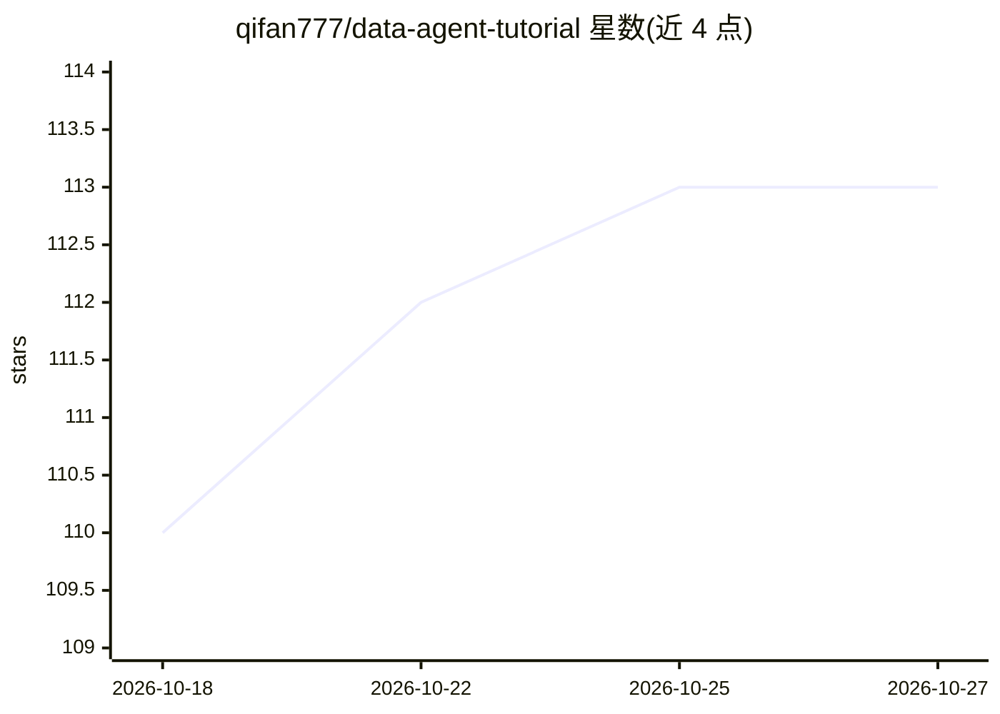

# qifan777/data-agent-tutorial

⭐ 113 · Kotlin · 推送 2026-07-15 · [GitHub](https://github.com/qifan777/data-agent-tutorial) · [官网](https://www.jarcheng.top/data-agent/) · 个人维护 · 中文 README

**从 0 到 1 构建 Text2SQL 智能体的实战教程项目**

学习型教程仓库：参考 spring-ai-alibaba/DataAgent 项目进行拆解、复现与讲解，围绕一个可运行的 Text2SQL Agent 应用，教授 StateGraph 图编排、结构化+非结构化双通道 RAG 检索、SQL 生成与自动纠错、Python Docker 沙盒执行、HITL 人工确认，以及 A2A 协议与 SSE 流式交互。技术栈为 Kotlin + Spring Boot 3.x + Spring AI Alibaba Graph + PostgreSQL/pgvector 后端与 Vue 3 前端，按 00-04 章节分支组织学习路径，需 Java 21+、Node.js 20+ 与 pgvector 环境，配置 OpenAI 兼容 API Key 后运行。

## 筛选速览

| 维度 | 判定 | 备注 |
|---|---|---|
| AI 角色 | `ai-knowledge` | 知识聚合/清单类 |
| 许可风险 | `none` | — |
| 部署形态 | `library` | 以包/库形式分发 |
| 模型依赖 | — | README 未给出锁定关系 |
| 硬件要求 | — | 无带数字的原话,不猜 |
| 安装摩擦 | `medium` | 含编译或系统依赖之一 |
| 成熟度 | — | 结构信号不足 |

## 能力要点

- StateGraph 编排覆盖理解/召回/规划/执行/纠错/报告全链路
- 关系图谱 + 业务知识库的双重 RAG 检索
- HITL 人工确认、SQL 自纠错与 Python Docker 沙盒执行
- A2A 协议 + SSE 流式交互，按 Git 分支章节化学习路径

## 适用场景

- 系统学习并亲手搭建 Text2SQL 智能体
- 了解高风险场景下 HITL 人机协同与流式交互设计
- 对照章节分支阅读源码逐步进阶 Agent 开发

## 场景标签

`教程课程` `数据分析` `RAG` · 领域:效率与自动化

## 证据(README 行号)

> L3: > 本项目是一个**基于开源项目的学习型教程**：在参考 `spring-ai-alibaba/DataAgent` 的基础上，结合个人理解进行拆解、复现与讲解。
> L4: > 目标是帮助开发者从 0 到 1 系统掌握 **StateGraph 图编排**、**双重 RAG 检索**、**自我纠错**、**HITL 人机协同** 等 Text2SQL Agent 关键能力。

## 星数曲线

2026-10-18 110 → 2026-10-27 113（+3）

---
*卡片 v1 · prompt 1.4 · 生成 2026-10-23 · 置信度 mid · 依据 README sha `d1362520f861` · [字段定义](../../DATASET.md)*
