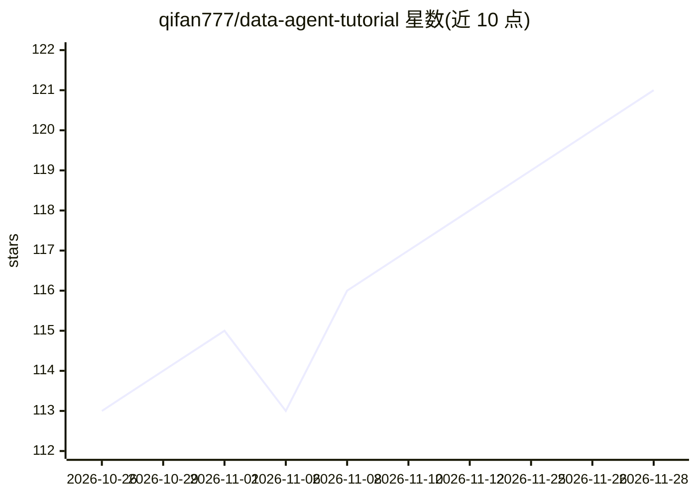

# qifan777/data-agent-tutorial

⭐ 121 · Kotlin · 推送 2026-11-05 · [GitHub](https://github.com/qifan777/data-agent-tutorial) · [官网](https://www.jarcheng.top/data-agent/) · 个人维护 · 中文 README

**Text2SQL 智能体构建实战教程：章节化拆解复现一个可运行项目**

基于 spring-ai-alibaba/DataAgent 的学习型教程项目，按章节组织（骨架搭建、A2A 协议、Graph 编程、知识库、SQL Agent 编排），建议配合 Git 分支对照阅读源码。技术栈为 Kotlin + Spring Boot + Spring AI Alibaba Graph + PostgreSQL/pgvector + Vue 3，后端经 gradlew 启动、前端经 pnpm 启动。模型调用走 OpenAI 兼容配置，README 中包含作者运营的 API 中转服务推广信息与代充联系方式。

## 筛选速览

| 维度 | 判定 | 备注 |
|---|---|---|
| AI 角色 | `ai-knowledge` | 知识聚合/清单类 |
| 许可风险 | `none` | — |
| 部署形态 | `library` | 以包/库形式分发 |
| 模型依赖 | — | README 未给出锁定关系 |
| 硬件要求 | — | 无带数字的原话,不猜 |
| 安装摩擦 | `medium` | 含编译或系统依赖之一 |
| 成熟度 | `idea` | |

## 能力要点

- 覆盖 StateGraph 编排、双重 RAG、HITL 人工确认、SQL 自纠错、Docker 沙盒执行等机制
- 章节化教程路线，建议切换到对应 Git 分支对照源码
- 后端 Kotlin + Spring AI Alibaba Graph，存储用 PostgreSQL + pgvector
- 前端 Vue 3 + TypeScript，通过 A2A 协议与 SSE 流式交互

## 适用场景

- 学习如何用 StateGraph 编排一个 Text2SQL 智能体
- 了解 HITL 人工确认与 SQL 自动纠错的实现方式
- 复现并改造一个含双重 RAG 的数据问答 Agent 项目

## 场景标签

`教程课程` `数据分析` `RAG` · 领域:效率与自动化

## 证据(README 行号)

> L3: > 本项目是一个**基于开源项目的学习型教程**：在参考 `spring-ai-alibaba/DataAgent` 的基础上，结合个人理解进行拆解、复现与讲解。
> L4: > 目标是帮助开发者从 0 到 1 系统掌握 **StateGraph 图编排**、**双重 RAG 检索**、**自我纠错**、**HITL 人机协同** 等 Text2SQL Agent 关键能力。
> L115: ## 📖 教程导航（自顶向下进阶）

## 星数曲线

2026-10-26 113 → 2026-11-28 121（+8）

---
*卡片 v1 · prompt 1.4 · 生成 2026-11-28 · 置信度 mid · 依据 README sha `a5eccea921bc` · [字段定义](../../DATASET.md)*
