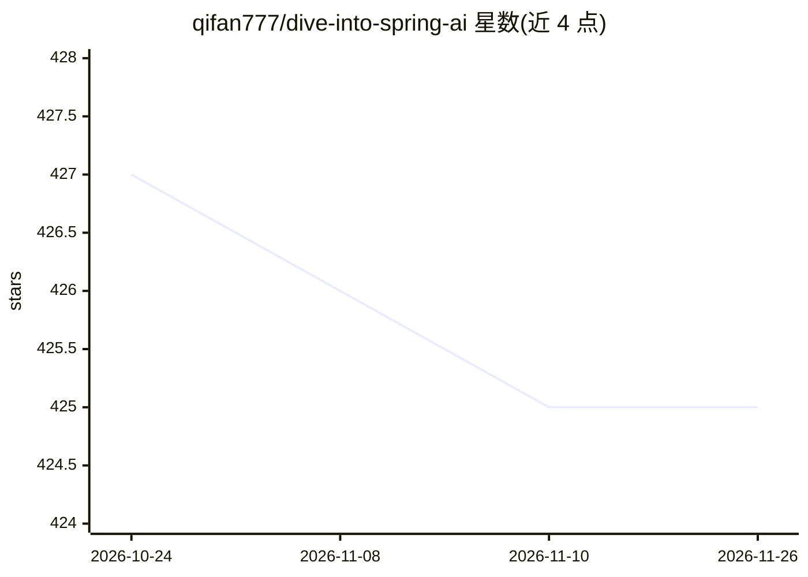

# qifan777/dive-into-spring-ai

⭐ 425 · Java · 推送 2026-11-05 · [GitHub](https://github.com/qifan777/dive-into-spring-ai) · [官网](https://www.jarcheng.top/blog/project/spring-ai/intro.html) · 个人维护 · 中文 README

**SpringAI 教学项目：覆盖 SSE/RAG/Agent 等知识点的配套代码**

以教学为目的的 Spring AI 示例项目，内容覆盖 SSE 流式输出、Agent 智能体、FunctionCall、Embedding、向量数据库、RAG、Graph RAG、历史消息、图片生成与图片理解等知识点，配套文档与视频地址。运行需 Java 17、Node.js 18+、MySQL 8、Redis-Stack（用于向量查询）、Neo4j 5+ 及 DashScope 或兼容 OpenAI 协议的 API Key；通过 git clone 后用 IDEA 运行后端、npm 运行前端。README 中含作者运营的 API 中转服务广告及 QQ 群联系方式。

## 筛选速览

| 维度 | 判定 | 备注 |
|---|---|---|
| AI 角色 | `ai-knowledge` | 知识聚合/清单类 |
| 许可风险 | `none` | — |
| 部署形态 | `self-host` | docker 或自建部署 |
| 模型依赖 | — | README 未给出锁定关系 |
| 硬件要求 | — | 无带数字的原话,不猜 |
| 安装摩擦 | `low` | 无编译、无系统依赖或容器化 |
| 成熟度 | — | 结构信号不足 |

## 能力要点

- 知识点覆盖 SSE 流/Agent/FunctionCall/RAG/Graph RAG/图片生成与理解
- 提供文档与视频两种学习入口
- Redis-Stack 拓展向量查询、Neo4j 支持 Graph RAG
- 兼容 OpenAI 协议模型可自定义 base-url 接入

## 适用场景

- 学习 Spring AI 的流式输出与历史消息实现
- 按教程搭建带知识库与知识图谱的 RAG 应用
- 参考示例代码实现 FunctionCall 与 Agent 功能

## 场景标签

`教程课程` `RAG` `知识图谱` · 领域:知识与检索

## 证据(README 行号)

> L3: 本项目使用SpringAI教学，包含了SSE流/Agent智能体/FunctionCall/Embedding/VectorDatabase/RAG/Graph RAG/历史消息/图片生成/图片理解
> L18: ## 运行环境

## 星数曲线

2026-10-24 427 → 2026-11-26 425（-2）

---
*卡片 v1 · prompt 1.4 · 生成 2026-11-25 · 置信度 mid · 依据 README sha `3a362ef42169` · [字段定义](../../DATASET.md)*
