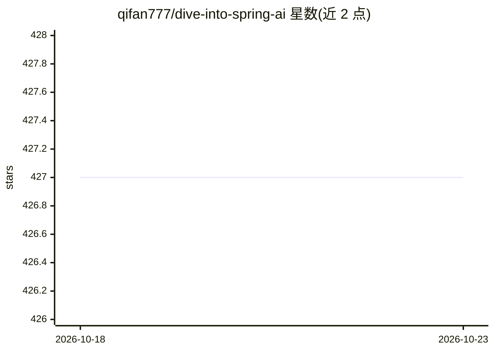

# qifan777/dive-into-spring-ai

⭐ 427 · Java · 推送 2026-07-15 · [GitHub](https://github.com/qifan777/dive-into-spring-ai) · [官网](https://www.jarcheng.top/blog/project/spring-ai/intro.html) · 个人维护 · 中文 README

**SpringAI 动手教学项目：SSE流/Agent/RAG/Graph RAG/FunctionCall 示例**

以 SpringAI 框架为主的中文教学示例工程，覆盖 SSE 流式输出、Agent 智能体、FunctionCall、Embedding、向量数据库、RAG、Graph RAG、历史消息、图片生成与图片理解等知识点。面向学习 Java 技术栈 AI 应用开发的开发者，需自备 Java 17、Node.js 18+、MySQL 8、Redis-Stack、Neo4j 5+ 与 DashScope API KEY（或 OpenAI 协议模型），提供前后端分离的运行步骤与视频/文档地址，另提供付费远程安装/定制服务入口。

## 筛选速览

| 维度 | 判定 | 备注 |
|---|---|---|
| AI 角色 | `ai-knowledge` | 知识聚合/清单类 |
| 许可风险 | `none` | — |
| 部署形态 | `self-host` | docker 或自建部署 |
| 模型依赖 | — | README 未给出锁定关系 |
| 硬件要求 | — | 无带数字的原话,不猜 |
| 安装摩擦 | `low` | 无编译、无系统依赖或容器化 |
| 成熟度 | — | 结构信号不足 |

## 能力要点

- 覆盖 SSE 流/Agent/FunctionCall/Embedding/RAG/Graph RAG 等 AI 应用知识点
- 前后端分离工程，含前端 npm 运行脚本与后端 IDEA 运行步骤
- 运行环境要求 Java 17、Node.js 18+、MySQL 8、Redis-Stack、Neo4j 5+
- 配置文件可切换 DashScope 或 OpenAI 协议模型端点

## 适用场景

- 跟随教程动手学习 SpringAI 各项 AI 能力的实现
- 参考 RAG 与 Graph RAG 示例搭建自己的 Java AI 应用
- 了解向量数据库与知识图谱在 Spring 技术栈中的接入方式

## 场景标签

`教程课程` `RAG` · 领域:知识与检索

## 证据(README 行号)

> L3: 本项目使用SpringAI教学，包含了SSE流/Agent智能体/FunctionCall/Embedding/VectorDatabase/RAG/Graph RAG/历史消息/图片生成/图片理解
> L18: ## 运行环境
> L23: - DashScope API KEY（或者其他）。如果使用 OpenAI 协议模型，可以前往 起凡 AI 中转站 注册，赠送25刀额度，支持 OpenAI 协议。

## 星数曲线

2026-10-18 427 → 2026-10-23 427（+0）

---
*卡片 v1 · prompt 1.4 · 生成 2026-10-21 · 置信度 mid · 依据 README sha `20e35ab00e95` · [字段定义](../../DATASET.md)*
