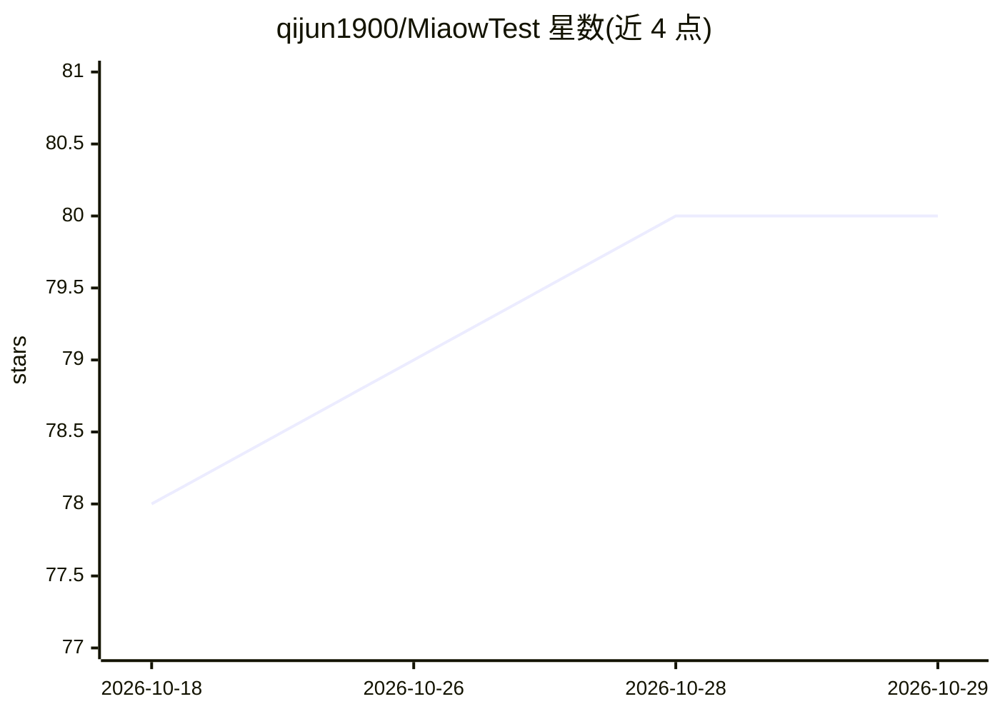

# qijun1900/MiaowTest

⭐ 80 · Vue · MIT · 推送 2026-08-01 · [GitHub](https://github.com/qijun1900/MiaowTest) · [官网](https://github.com/qijun1900/MiaoTest) · 个人维护 · 中文 README

**跨平台智能刷题系统：多题型练习+AI 对话与学习工具**

面向学员的跨平台刷题与学习系统，一套代码覆盖微信小程序、H5、App。由三部分组成：Uni-app+Vue3 用户端（多题型刷题、错题沉淀、学习统计、计时器/TODO 等工具）、Vue3 管理端（题库管理、Agent 配置、数据看板）、Express+MongoDB 后端。AI 能力基于 LangChain.js + DashScope：多轮对话链、流式输出（SSE/分块/WebSocket 自适应）、DeepSeek-R1 推理链思考/回答分离渲染，另含 RAG（ChromaDB）与 AI 批量导题。需 Node.js>=18、npm>=8、MongoDB>=6，提供 Docker Compose 部署。

## 筛选速览

| 维度 | 判定 | 备注 |
|---|---|---|
| AI 角色 | `ai-native` | 本体是模型或模型工具 |
| 许可风险 | `permissive` | MIT |
| 部署形态 | `self-host` | docker 或自建部署 |
| 模型依赖 | — | README 未给出锁定关系 |
| 硬件要求 | — | 无带数字的原话,不猜 |
| 安装摩擦 | `low` | 无编译、无系统依赖或容器化 |
| 成熟度 | — | 结构信号不足 |

## 能力要点

- LangChain 多轮对话链与流式输出（SSE/WebSocket/小程序分块自适应）
- DeepSeek-R1 推理链：思考过程与回答分离渲染
- RAG 检索链（ChromaDB 向量存储）与 DashScope AI 导题/题目分析
- 多主题/深浅模式/四档字号 token 化外观系统

## 适用场景

- 在手机上刷选择题、填空题并沉淀错题复习
- 与 AI 助手对话答疑并查看深度思考过程
- 管理者通过 Web 后台维护题库与 Agent 配置

## 场景标签

`AI 助手` · 领域:对话与助手

## 证据(README 行号)

> L23: |**用户端**|Uni-app + Vue3 + Pinia + uView Plus|面向学员的移动端，支持刷题、AI 对话、错题沉淀、学习统计 、多种学习工具|
> L41: |**AI 对话 (Mio)**|基于 LangChain 的多轮 AI 对话，支持流式输出（SSE / WebSocket / 小程序分块传输自适应）|
> L67: |**LLM 引擎**|LangChain.js + DashScope（阿里云）统一模型接入层|

## 星数曲线

2026-10-18 78 → 2026-10-29 80（+2）

---
*卡片 v1 · prompt 1.4 · 生成 2026-10-24 · 置信度 high · 依据 README sha `111614cc1ad7` · [字段定义](../../DATASET.md)*
