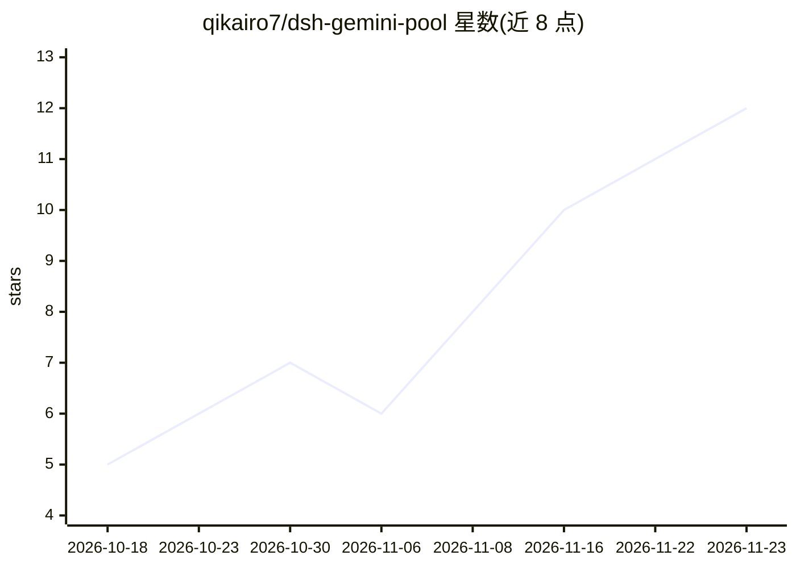

# qikairo7/dsh-gemini-pool

⭐ 12 · JavaScript · MIT · 推送 2026-11-21 · [GitHub](https://github.com/qikairo7/dsh-gemini-pool) · [官网](https://github.com/qikairo7/dsh-gemini-pool/releases) · 个人维护 · 中文 README

**把 Google AI Pro 订阅接入 DSH 编程环境的多账号 Gemini 插件**

DeepSeek Harness（DSH）的插件，通过 Google Antigravity / Cloud Code Assist 通道把已有的 Google AI Pro 订阅接入 DSH，无需另购 API key，订阅额度即用即扣。支持多 Google 账号组成账号池：按剩余额度加权轮询、429 无感切换、坏账号自动冷却与探活恢复；主模型无视觉能力时由池内 Gemini 自动转述贴图；另提供生图工具与中英双语设置页。README 声明其为非官方第三方工具，并提示存在违反 Google 服务条款导致封号的风险。

## 筛选速览

| 维度 | 判定 | 备注 |
|---|---|---|
| AI 角色 | `ai-ecosystem` | LLM/agent 周边工具 |
| 许可风险 | `permissive` | MIT |
| 部署形态 | `library` | 以包/库形式分发 |
| 模型依赖 | — | README 未给出锁定关系 |
| 硬件要求 | — | 无带数字的原话,不猜 |
| 安装摩擦 | `low` | 无编译、无系统依赖或容器化 |
| 成熟度 | — | 结构信号不足 |

## 能力要点

- 多 Google 账号池：按剩余额度加权轮询、429 无感切换、冷却与探活自动恢复
- 无视觉主模型的看图旁路：池内 Gemini 自动转述贴图为文字回喂
- antigravity_image_generate 生图工具与 antigravity_read_image 图片细看工具
- 设置页实时显示每账号每周 / 5 小时额度与模型目录

## 适用场景

- 让 DSH 编程助手直接使用 Google AI Pro 订阅额度而无需 API key
- 多个 Google 账号叠加额度、自动调度避免撞限流
- 纯文本主模型编程时贴图查看截图或界面素材

## 场景标签

`图像生成` `多模态` `模型网关` · 领域:Agent 开发

## 证据(README 行号)

> L23: DeepSeek Harness（DSH） 本身无法直连 Gemini。这个插件补上这条通路：通过 Google Antigravity / Cloud Code Assist 通道，把你已有的 **Google AI Pro 订
> L27: 不止一个 Google 账号？全部加进来组成**账号池**：按剩余额度做前置加权轮询、429 无感切换、坏账号自动冷却与探活恢复。设置页可下拉查看每个账号的每周 / 5 小时额度，也可展开全部账号卡片对照。

## 星数曲线

2026-10-18 5 → 2026-11-23 12（+7）

---
*卡片 v1 · prompt 1.4 · 生成 2026-11-19 · 置信度 mid · 依据 README sha `cd914fa03056` · [字段定义](../../DATASET.md)*
