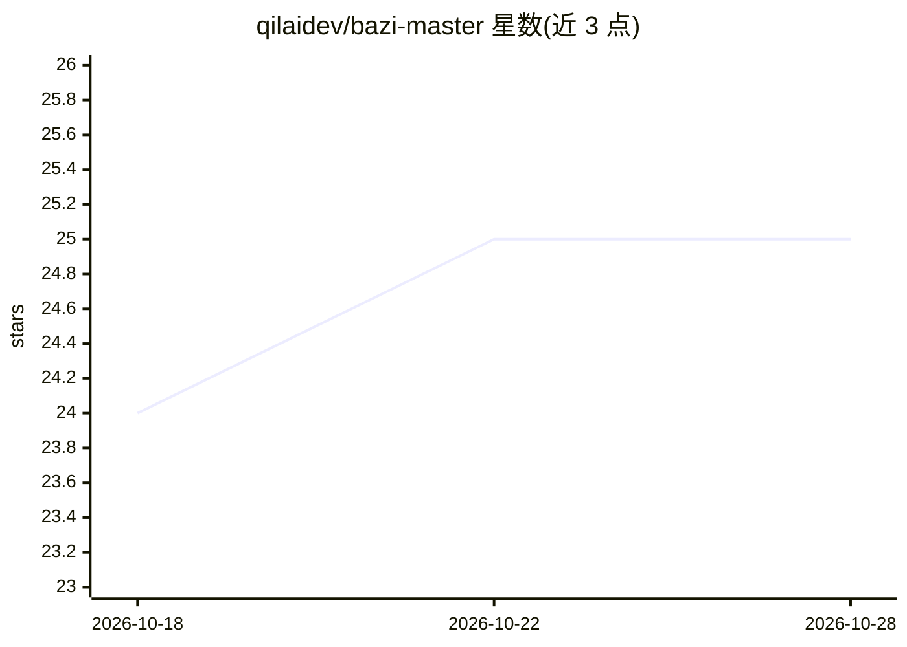

# qilaidev/bazi-master

⭐ 25 · JavaScript · MIT · 推送 2026-08-30 · [GitHub](https://github.com/qilaidev/bazi-master) · [官网](https://github.com/tytsxai/bazi-master#readme) · 组织维护 · 中文 README

**八字/塔罗/周易/星座/紫微全栈占卜 Web 应用参考实现**

用 React 18 + Vite + Express + Prisma + PostgreSQL 实现的开源全栈玄学应用骨架：覆盖八字排盘、塔罗抽牌、周易起卦、星座与合盘、紫微斗数，附带用户系统（OAuth/邮箱登录）、历史记录与收藏、多语言（5 种）、OpenAPI 文档和 WebSocket AI 流式输出。AI 部分为可选的解读功能，支持 mock/OpenAI/Anthropic 文本解读与 OpenAI 图片生成，未配置密钥时默认 mock。定位为可 fork、自部署、二次开发的工程样板，非托管 SaaS；输出仅适合娱乐与文化研究。提供 ./bazi CLI 收敛环境准备、迁移、测试与端到端校验。

## 筛选速览

| 维度 | 判定 | 备注 |
|---|---|---|
| AI 角色 | `ai-enhanced` | 去掉 AI 部分产品仍成立 |
| 许可风险 | `permissive` | MIT |
| 部署形态 | `None` |  |
| 模型依赖 | — | README 未给出锁定关系 |
| 硬件要求 | — | 无带数字的原话,不猜 |
| 安装摩擦 | `low` | 无编译、无系统依赖或容器化 |
| 成熟度 | — | 结构信号不足 |

## 能力要点

- 八字四柱/五行/十神/大运排盘，含真太阳时元数据与缓存
- AI 解读支持 mock/OpenAI/Anthropic，WebSocket /ws/ai 流式输出
- 用户系统：邮箱+Google/WeChat OAuth、密码重置、自助删号
- ./bazi 程序化 CLI，全命令支持 --json 与约定退出码

## 适用场景

- 学习把多个命理/占星模块组合成完整 React Web 应用
- 自部署构建命理、占星、娱乐向 AI 应用原型
- 参考 Express+Prisma+PostgreSQL 的登录、历史记录、健康检查与 OpenAPI 组织方式

## 场景标签

 · 领域:命理/占卜 Web 应用

## 证据(README 行号)

> L5: BaZi Master 是一个开源全栈参考项目，用 React + Express + Prisma 实现八字排盘（BaZi chart）、塔罗抽牌（Tarot draw）、周易起卦（I Ching divination）、星座与上
> L22: |AI 能力|支持 mock / OpenAI / Anthropic 文本解读；Soul Portrait 图片生成当前通过 OpenAI 或 mock 占位|
> L39: - **AI 八字解读 AI interpretation**：登录后可请求八字解读或完整分析；未配置真实密钥时使用 mock provider。

## 星数曲线

2026-10-18 24 → 2026-10-28 25（+1）

---
*卡片 v1 · prompt 1.4 · 生成 2026-10-26 · 置信度 high · 依据 README sha `8116f9cfcb3a` · [字段定义](../../DATASET.md)*
