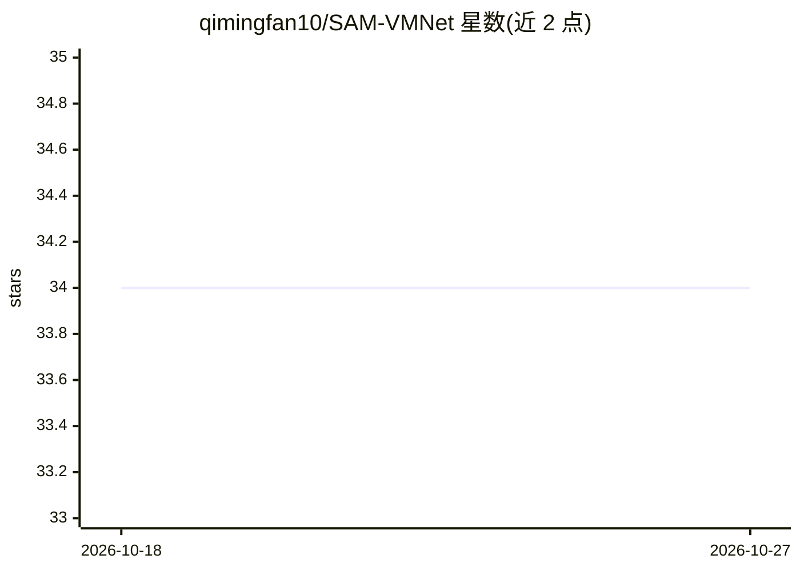

# qimingfan10/SAM-VMNet

⭐ 34 · Python · Apache-2.0 · 推送 2026-01-12 · [GitHub](https://github.com/qimingfan10/SAM-VMNet) · [官网](https://qimingfan10-sam-vmne-7xdv.bolt.host/) · 组织维护

**冠脉血管分割与狭窄检测的深度学习研究代码（Medical Physics 论文官方仓库）**

论文《Deep learning model for coronary artery segmentation and quantitative stenosis detection in angiographic images》官方代码库，发表于 Medical Physics。模型结合 VMUnet 与 SAM（Segment Anything Model）进行血管造影图像的冠状动脉分割，采用两分支训练流程，需从 Google Drive 下载预训练权重、ARCADE 数据集训练。另含 MATLAB 编写的狭窄检测模块：骨架化提取中心线、矩方法计算半径、路径查找与狭窄程度分级可视化（需 MATLAB R2016b+ 与 Image Processing Toolbox）。附带 React+TailwindCSS 项目展示网站。

## 筛选速览

| 维度 | 判定 | 备注 |
|---|---|---|
| AI 角色 | `ai-native` | 本体是模型或模型工具 |
| 许可风险 | `permissive` | Apache-2.0 |
| 部署形态 | `library` | 以包/库形式分发 |
| 模型依赖 | — | README 未给出锁定关系 |
| 硬件要求 | — | 无带数字的原话,不猜 |
| 安装摩擦 | `low` | 无编译、无系统依赖或容器化 |
| 成熟度 | — | 结构信号不足 |

## 能力要点

- VMUnet 与 SAM 结合的两分支血管分割架构
- MATLAB 狭窄检测模块：中心线提取、半径计算、狭窄程度量化与彩色分级可视化
- 预训练权重与 ARCADE 数据集驱动的 train/test 脚本流程

## 适用场景

- 复现论文中的冠状动脉分割与狭窄检测实验
- 在 ARCADE 数据集上训练或测试血管分割模型
- 对分割后的血管掩码做狭窄程度定量分析

## 场景标签

`图像视频处理` · 领域:感知与多模态

## 证据(README 行号)

> L5: This is the official code repository for "Deep learning model for coronary artery segmentation and quantitative sten
> L11: *Figure 1: The overall architecture of SAM-VMNet combining VMUnet (Vision-based Medical Network) with SAM (Segment 

## 星数曲线

2026-10-18 34 → 2026-10-27 34（+0）

---
*卡片 v1 · prompt 1.4 · 生成 2026-10-25 · 置信度 high · 依据 README sha `65bf0b629f48` · [字段定义](../../DATASET.md)*
