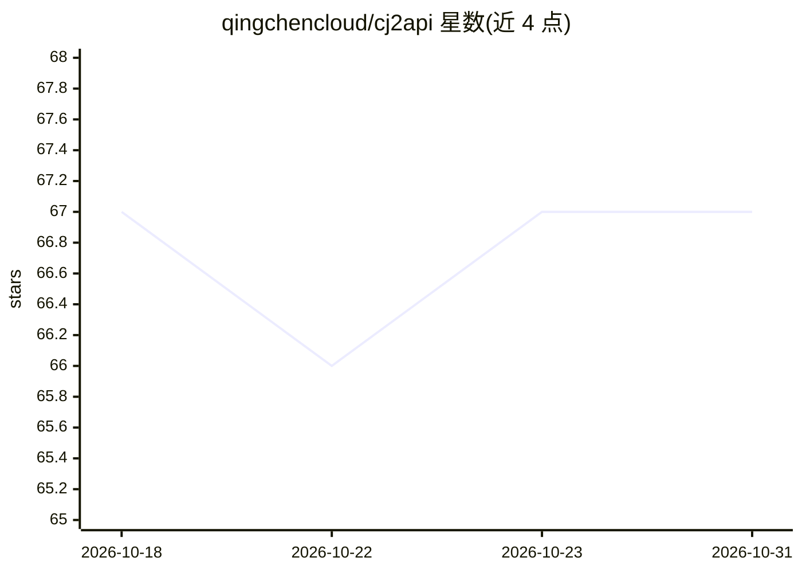

# qingchencloud/cj2api

⭐ 67 · TypeScript · MIT · 推送 2026-05-09 · [GitHub](https://github.com/qingchencloud/cj2api) · [官网](https://cj2api.qt.cool/) · 个人维护 · 中文 README

**将 ChatJimmy 转为 OpenAI 兼容 API 的代理 Worker**

用 TypeScript 编写的 Cloudflare Workers / 腾讯云 EdgeOne Pages 代理服务：把 ChatJimmy 封装为标准 /v1/chat/completions 接口，支持流式 SSE 与非流式响应，提供 /v1/models、usage Token 统计和根路径内置测试页。无第三方运行时依赖，API Key 可任意字符串填写。提供 npm 安装、git clone 部署与本地 dev（localhost:8787）三种途径，README 声明仅供学习研究、禁止商业用途。

## 筛选速览

| 维度 | 判定 | 备注 |
|---|---|---|
| AI 角色 | `ai-ecosystem` | LLM/agent 周边工具 |
| 许可风险 | `permissive` | MIT |
| 部署形态 | `library` | 以包/库形式分发 |
| 模型依赖 | — | README 未给出锁定关系 |
| 硬件要求 | — | 无带数字的原话,不猜 |
| 安装摩擦 | `low` | 无编译、无系统依赖或容器化 |
| 成熟度 | — | 结构信号不足 |

## 能力要点

- 标准 OpenAI Chat Completions 接口，兼容官方 SDK 与各类客户端
- 同时支持 Cloudflare Workers 与腾讯云 EdgeOne Pages 部署
- 流式 SSE 输出与 usage Token 统计，内置在线测试页
- 纯 TypeScript，无第三方运行时依赖

## 适用场景

- 把 ChatJimmy 接入依赖 OpenAI API 格式的客户端或框架
- 在国内通过 EdgeOne 部署低延迟的 API 端点
- 零服务器运维获得可测试的 LLM API 代理

## 场景标签

`模型网关` · 领域:Agent 开发

## 证据(README 行号)

> L3: 将 ChatJimmy 转换为 OpenAI 兼容 API 的工具，支持 Cloudflare Workers 和腾讯云 EdgeOne Pages。
> L5: 一键部署到 Cloudflare 或 EdgeOne，即可获得标准的 `/v1/chat/completions` 接口，兼容所有支持 OpenAI API 的客户端和框架。无需 API Key。

## 星数曲线

2026-10-18 67 → 2026-10-31 67（+0）

---
*卡片 v1 · prompt 1.4 · 生成 2026-10-24 · 置信度 high · 依据 README sha `8e5665954c86` · [字段定义](../../DATASET.md)*
