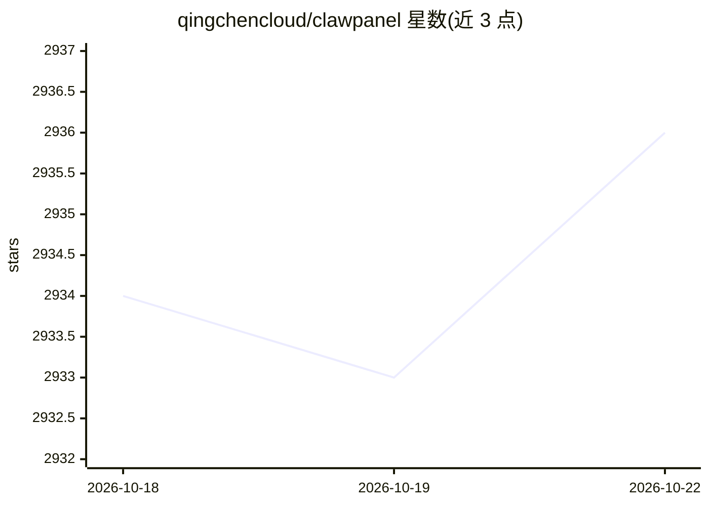

# qingchencloud/clawpanel

⭐ 2,937 · JavaScript · NOASSERTION · 推送 2026-10-20 · [GitHub](https://github.com/qingchencloud/clawpanel) · [官网](https://claw.qt.cool) · 组织维护 · 中文 README

**多 AI Agent 框架的可视化管理桌面面板，内置可操作系统级 AI 助手**

基于 Tauri v2 的跨平台桌面应用（另有纯 Web 版与 Docker 部署），统一管理 OpenClaw、Hermes Agent、DeepSeek Harness、OpenCode 及实验版 Pi 五种 Agent 引擎：启停控制、版本检测、模型渠道同步、Agent/记忆/消息渠道/定时任务与 Token 用量管理。内置 AI 助手提供 4 种权限模式与 8 个工具（执行命令、读写文件、进程/端口检测等），可诊断配置、一键排障、整理 Issue 并生成修复 PR。桌面版提供 macOS/Windows/Linux 安装包，Web 版需 Node.js 18+。配套晴辰云免费测试平台与第三方赞助推广接入。给需要在本地或服务器集中运营多个 Agent 的用户使用。

## 筛选速览

| 维度 | 判定 | 备注 |
|---|---|---|
| AI 角色 | `ai-ecosystem` | LLM/agent 周边工具 |
| 许可风险 | `none` | NOASSERTION |
| 部署形态 | `desktop` | 安装包/桌面程序 |
| 模型依赖 | locked-api |  |
| 硬件要求 | — | 无带数字的原话,不猜 |
| 安装摩擦 | `low` | 无编译、无系统依赖或容器化 |
| 成熟度 | `idea` | |

## 能力要点

- 支持 OpenClaw / Hermes / DSH / OpenCode / Pi 五种引擎的统一管理与切换
- 内置 AI 助手：4 种操作模式（聊天/规划/执行/无限）+ 8 个系统操作工具
- PR 助手可分析 Bug、定位代码并通过 git 命令完成 Fork/Branch/Commit/Push
- 多引擎消息渠道（Telegram/Discord/飞书/钉钉/QQ）统一管理与 Token 用量统计

## 适用场景

- 在一台机器上集中安装、启动和升级多个 AI Agent 引擎
- 让内置 AI 助手读取配置和日志，自动诊断并修复常见问题
- 在无桌面环境的 Linux 服务器上通过浏览器远程管理 Agent

## 场景标签

`AI 助手` · 领域:对话与助手

## 证据(README 行号)

> L26: ClawPanel 是支持多 AI Agent 框架的可视化管理面板，目前支持 OpenClaw、Hermes Agent、DeepSeek Harness、OpenCode 和实验版 Pi。**内置智能 AI 助手**，帮你一键
> L366: - **🧩 多引擎架构** — 支持 OpenClaw、Hermes Agent、DeepSeek Harness、OpenCode，以及实验版 Pi；自由切换，各自独立管理
> L368: - **🧪 DeepSeek Harness 工作台** — 面板内完成受管安装、模型渠道同步和完整 DSH Web 操作，无需另开页面或额外开放端口

## 星数曲线

2026-10-18 2,934 → 2026-10-22 2,936（+2）

---
*卡片 v1 · prompt 1.4 · 生成 2026-10-21 · 置信度 mid · 依据 README sha `0b0ae098bbc1` · [字段定义](../../DATASET.md)*
