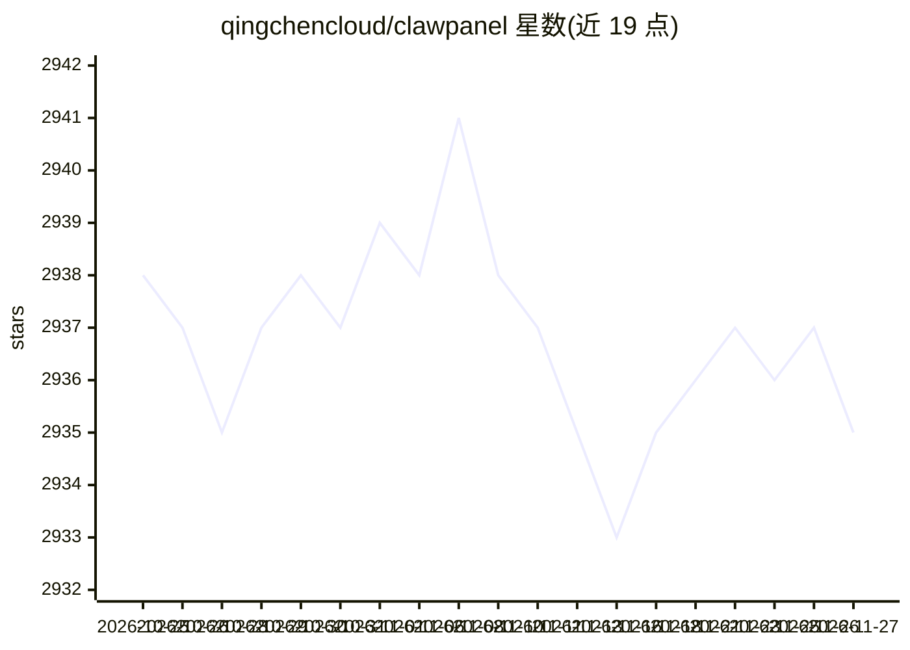

# qingchencloud/clawpanel

⭐ 2,935 · JavaScript · NOASSERTION · 推送 2026-11-18 · [GitHub](https://github.com/qingchencloud/clawpanel) · [官网](https://claw.qt.cool) · 组织维护 · 中文 README

**管理多个 AI Agent 框架的桌面/Web 可视化面板，内置排障助手**

ClawPanel 是基于 Tauri v2 的跨平台管理面板，用于安装、启动、配置和监控 OpenClaw、Hermes Agent、DeepSeek Harness、OpenCode 及实验版 Pi 等多类 Agent 运行时，功能覆盖服务启停、模型渠道同步、消息渠道接入（Telegram/Discord/飞书/钉钉/QQ）、Token 用量统计、记忆文件编辑与日志查看。内置 AI 助手提供 4 种权限模式、8 个工具（执行命令/读写文件/检测端口等）与 ask_user 交互问答，可自动诊断配置并生成修复 PR。提供 Windows/macOS/Linux 安装包、Docker 镜像与无 GUI 的 Web 部署模式，支持 ARM64 开发板；Web 版需 Node.js 18+。

## 筛选速览

| 维度 | 判定 | 备注 |
|---|---|---|
| AI 角色 | `ai-ecosystem` | LLM/agent 周边工具 |
| 许可风险 | `none` | NOASSERTION |
| 部署形态 | `desktop` | 安装包/桌面程序 |
| 模型依赖 | locked-api |  |
| 硬件要求 | — | 无带数字的原话,不猜 |
| 安装摩擦 | `low` | 无编译、无系统依赖或容器化 |
| 成熟度 | — | 结构信号不足 |

## 能力要点

- 多引擎架构：OpenClaw、Hermes Agent、DeepSeek Harness、OpenCode、Pi 独立管理与切换
- 内置 AI 助手：聊天/规划/执行/无限四种模式，工具调用需确认可控
- Hermes 长期记忆与人格在线编辑，会话与工具调用链路可视化
- 三种部署形态：桌面安装包、Docker、零 GUI 的 Web 版（兼容 ARM64 开发板）

## 适用场景

- 在一台服务器或开发板上统一部署和管理多个 Agent 运行时
- 不熟悉命令行时用 AI 助手自动诊断 Gateway 配置并排障
- 统一接入 Telegram/Discord/飞书/钉钉/QQ 等消息渠道并统计 Token 用量

## 场景标签

`AI 助手` `LLM 可观测性` · 领域:对话与助手

## 证据(README 行号)

> L26: ClawPanel 是支持多 AI Agent 框架的可视化管理面板，目前支持 OpenClaw、Hermes Agent、DeepSeek Harness、OpenCode 和实验版 Pi。**内置智能 AI 助手**，帮你一键
> L353: - **🧩 多引擎架构** — 支持 OpenClaw、Hermes Agent、DeepSeek Harness、OpenCode，以及实验版 Pi；自由切换，各自独立管理
> L362: - **运行时管理** — OpenClaw Gateway 以及 DSH、OpenCode、Pi 独立运行时的状态、版本和生命周期控制

## 星数曲线

2026-10-25 2,938 → 2026-11-27 2,935（-3）

---
*卡片 v1 · prompt 1.4 · 生成 2026-11-23 · 置信度 high · 依据 README sha `0166b3469bec` · [字段定义](../../DATASET.md)*
