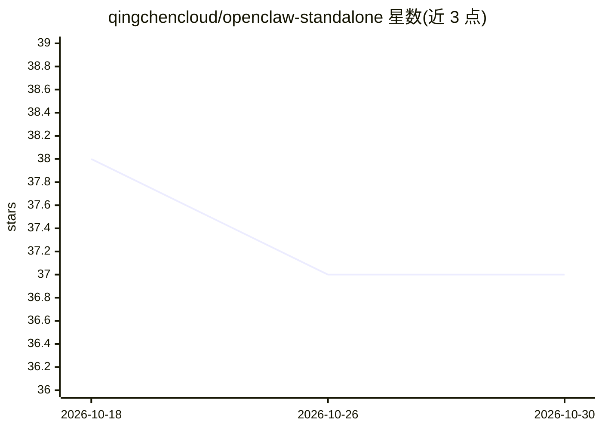

# qingchencloud/openclaw-standalone

⭐ 37 · Shell · NOASSERTION · 推送 2026-07-14 · [GitHub](https://github.com/qingchencloud/openclaw-standalone) · [官网](https://github.com/qingchencloud/openclaw-standalone/releases) · 组织维护 · 中文 README

**OpenClaw 零依赖跨平台预编译安装包分发器**

由晴辰云构建维护的 OpenClaw AI 智能体引擎独立安装包项目：在 CI 各平台 runner 上预编译原生模块，打包 Node.js 运行时与完整 node_modules 为自包含发行包，免去 npm 安装的 Node.js/npm/Git 环境要求与国内网络慢的问题。同时提供官方原版与汉化版，覆盖 Windows/macOS/Linux/树莓派，Windows 提供 .exe 安装向导与绿色免安装版。安装包体积 200-300MB。面向不想配置 Node 环境或受国内网络限制的用户。

## 筛选速览

| 维度 | 判定 | 备注 |
|---|---|---|
| AI 角色 | `ai-ecosystem` | LLM/agent 周边工具 |
| 许可风险 | `dual` | NOASSERTION |
| 部署形态 | `desktop` | 安装包/桌面程序 |
| 模型依赖 | — | README 未给出锁定关系 |
| 硬件要求 | — | 无带数字的原话,不猜 |
| 安装摩擦 | `medium` | 含编译或系统依赖之一 |
| 成熟度 | — | 结构信号不足 |

## 能力要点

- 双版本（官方原版/汉化版）从同一 CI 流水线构建，功能一致仅界面语言不同
- Windows 提供 .exe 引导安装向导，自动配置 PATH
- 支持 macOS ARM64/x64、Linux x64/ARM64（树莓派 4/5）
- macOS/Linux 提供一键 curl 安装脚本

## 适用场景

- 国内网络环境下免 npm 快速安装 OpenClaw
- 无 Node.js 环境的机器上直接运行 openclaw CLI
- 在树莓派等 ARM64 设备上部署 OpenClaw

## 场景标签

 · 领域:AI agent 工具链/软件分发

## 证据(README 行号)

> L14: OpenClaw 是一个强大的 AI 智能体引擎，但官方安装方式依赖 `npm install -g`，存在以下痛点：
> L125: 本项目的核心思想：**在 CI 的各平台 runner 上预编译所有原生模块，打包 Node.js 运行时 + 完整 node_modules 成自包含发行包。**

## 星数曲线

2026-10-18 38 → 2026-10-30 37（-1）

---
*卡片 v1 · prompt 1.4 · 生成 2026-10-25 · 置信度 mid · 依据 README sha `d098d3e5e452` · [字段定义](../../DATASET.md)*
